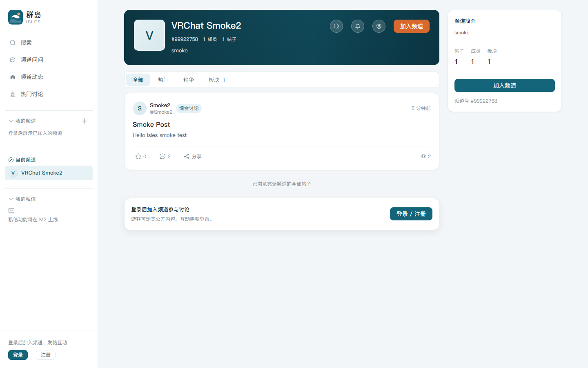
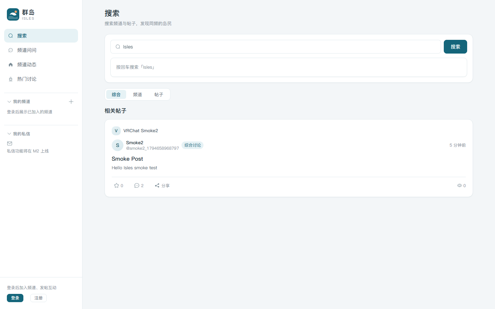

# 群岛（Isles）· 社交频道平台

> 每个频道是一座岛，在群岛之间找到同频的人。
> 项目状态：**M1 开发启动**（需求已确认，按三期交付）
> 文档版本：v0.3.0 · 最后更新：2026-11-14

社交频道平台：为社区、团队与兴趣群体提供「频道」化的内容发布与实时交流能力。
具体功能范围以 [需求规格](docs/03-需求规格.md) 为准。

## 当前阶段

| 阶段 | 状态 | 产出 |
| --- | --- | --- |
| 1. 工程规范与文档体系 | ✅ 已完成 | `docs/00-工程开发规范.md`、`docs/01-文档体系与维护规范.md` |
| 2. 架构确认 | 🔄 评审中（待确认） | `docs/02-架构设计.md`、ADR-0002～0004 |
| 3. 需求分析 | ✅ 已确认 | `docs/03-需求规格.md`、`docs/04-领域模型与词汇表.md` |
| 4. 迭代开发 | 🔄 M1 进行中 | 代码 + 契约（OpenAPI）+ ADR + 测试 |

## 技术栈

| 层 | 选型 |
| --- | --- |
| 前端 | Vue 3 + TypeScript + Vite + Element Plus（Pinia / Vue Router） |
| 后端 | Spring Boot 4.1.2（Java 17）+ Spring Security + MyBatis-Plus + Flyway |
| 数据 | MySQL 8.0 + Redis 7 |
| 实时 | Spring WebSocket + STOMP |
| 部署 | Docker Compose + Nginx（单机自托管） |

选型依据见 [架构设计](docs/02-架构设计.md) 与 [ADR-0002](docs/adr/ADR-0002-技术栈选型.md)。

## 文档导航

| 文档 | 说明 |
| --- | --- |
| [docs/README.md](docs/README.md) | 文档总索引与状态看板 **← 先看这里** |
| [工程开发规范](docs/00-工程开发规范.md) | 编码、Git、评审、测试、API、安全、发布等强制性规范 |
| [文档体系与维护规范](docs/01-文档体系与维护规范.md) | 需要维护哪些文档、谁维护、何时更新、如何评审 |
| [架构设计](docs/02-架构设计.md) | 系统架构、技术选型、模块划分（已批准） |
| [需求规格](docs/03-需求规格.md) | 功能需求、信息架构、通用模块、数据中心设计、分期方案（已批准） |
| [领域模型与词汇表](docs/04-领域模型与词汇表.md) | 领域术语与模型（草案） |
| [API 设计](docs/05-API设计.md) | M1 接口契约与约定（草案） |
| [数据库设计](docs/06-数据库设计.md) | M1 表结构与索引（草案） |
| [路线图与里程碑](docs/10-路线图与里程碑.md) | M1/M2/M3 范围与验收（草案） |
| [决策记录（ADR）](docs/adr/README.md) | 重大技术与架构决策，一决策一记录 |

## 开发约定（摘要）

- 一切变更走 PR；`main` 始终可发布。
- 提交信息遵循 Conventional Commits（见 [规范 §4](docs/00-工程开发规范.md)）。
- 文档与代码同 PR 更新；重大决策写 ADR。
- 完成 = 代码 + 测试通过 + 文档更新 + 自检清单通过。

详细规则见 [docs/00-工程开发规范.md](docs/00-工程开发规范.md)。

## 快速开始（本地开发）

> M1 已在 Windows + JDK 17 + MySQL 8.0 + Node 26 环境验证；Redis 在 M2 接入前非必需（令牌存 DB）。

前置：JDK 17（`JAVA_HOME`）、Maven 3.9+、MySQL 8.0、Node 20+ / pnpm。

1. 创建数据库与专用账号（示例，按需改密码）：

   ```sql
   CREATE DATABASE my_social_channel CHARACTER SET utf8mb4 COLLATE utf8mb4_0900_ai_ci;
   CREATE DATABASE my_social_channel_test CHARACTER SET utf8mb4 COLLATE utf8mb4_0900_ai_ci;
   CREATE USER 'isles_app'@'localhost' IDENTIFIED BY 'change-me';
   GRANT ALL PRIVILEGES ON my_social_channel.* TO 'isles_app'@'localhost';
   GRANT ALL PRIVILEGES ON my_social_channel_test.* TO 'isles_app'@'localhost';
   ```

2. 配置环境变量（参考 [`backend/.env.example`](backend/.env.example)；本地可写入根目录 `.env.local`，已被 git 忽略）：

   ```powershell
   $env:DB_URL = "jdbc:mysql://127.0.0.1:3306/my_social_channel?useUnicode=true&characterEncoding=utf8&serverTimezone=UTC&useSSL=false&allowPublicKeyRetrieval=true"
   $env:DB_USERNAME = "isles_app"
   $env:DB_PASSWORD = "change-me"
   $env:JWT_SECRET = "至少32字节的本地开发密钥-local-dev-only"
   ```

3. 启动后端（Flyway 自动建表，健康检查 `/actuator/health`）：

   ```powershell
   cd backend
   mvn spring-boot:run
   ```

4. 启动前端（Vite 代理 `/api`、`/uploads` 到 8080）：

   ```powershell
   cd frontend
   pnpm install
   pnpm dev        # http://127.0.0.1:5173
   ```

5. 测试与构建：

   ```powershell
   cd backend;  mvn -B test
   cd frontend; pnpm build
   ```

> 认证方式：access token 仅存前端内存，refresh token 走 HttpOnly Cookie；游客可浏览公开内容，
> 互动需要登录。接口契约见 [docs/05-API设计.md](docs/05-API设计.md)。

## 界面预览（M1）

| 频道页 | 帖子详情 | 搜索 |
| --- | --- | --- |
|  |  |  |

## 目录结构

```
MySocialChannel/
├── README.md                 # 项目入口
├── CHANGELOG.md              # 版本变更记录
├── CONTRIBUTING.md           # 贡献入口（指向规范）
├── docs/                     # 全部项目文档（唯一事实来源）
│   ├── 00-工程开发规范.md
│   ├── 01-文档体系与维护规范.md
│   ├── 02-架构设计.md
│   ├── 03-需求规格.md
│   ├── 04-领域模型与词汇表.md
│   ├── 05-API设计.md / 06-数据库设计.md / 07-安全与合规.md
│   ├── 10-路线图与里程碑.md
│   ├── adr/                  # 架构决策记录
│   ├── templates/            # 文档模板
│   └── assets/screenshots/   # 界面截图
├── backend/                  # Spring Boot 4.1 后端（Maven，com.isles）
│   ├── src/main/java/com/isles/{common,config,auth,user,channel,post,comment,interaction,feed,search,notification,media}
│   └── src/main/resources/db/migration/   # Flyway V1__init.sql
└── frontend/                 # Vue 3 + TypeScript + Vite 前端
    └── src/{api,components,composables,layouts,pages,router,stores,styles,types,utils}
```
