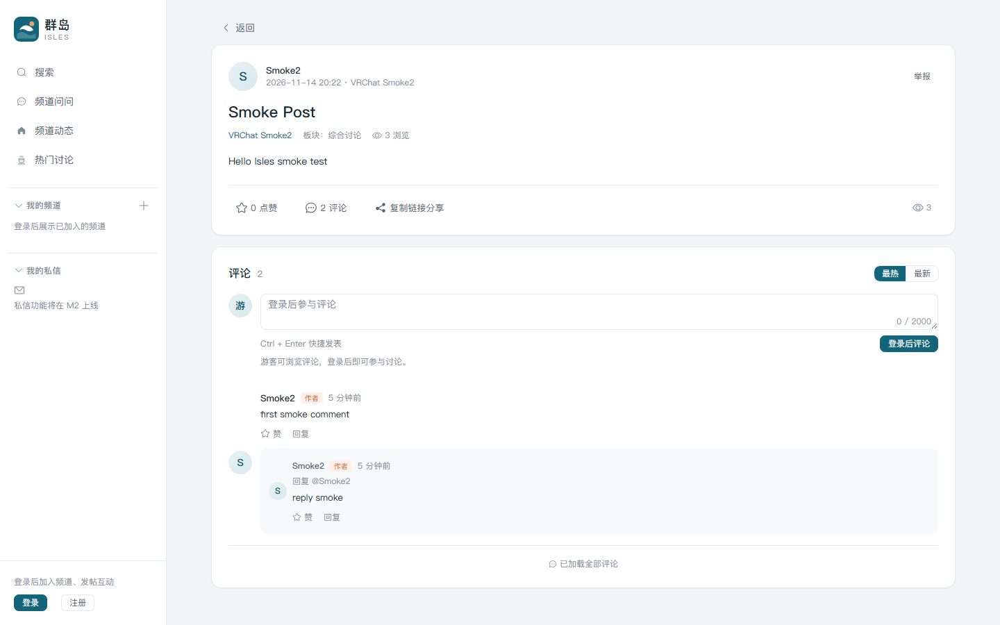

# 群岛（Isles）· 社交频道平台

> 每个频道是一座岛，在群岛之间找到同频的人。

以「频道」为组织单元的社区平台：用户创建/加入频道，在频道内发帖、评论、互动；平台提供全站发现（动态 / 热门 / 搜索 / 推荐）与 AI 能力（频道问问、频道助手），频道主通过**频道管理中心**运营频道。

- 前端：Vue 3 + TypeScript + Vite + Element Plus
- 后端：Spring Boot 4.1.2（Java 17）+ Spring Security + MyBatis-Plus + Flyway
- 数据：MySQL 8.0（Redis 可选，仅多实例共享限流时使用）
- 实时：Spring WebSocket + STOMP

功能范围与验收标准见 [需求规格](docs/03-需求规格.md)，接口契约见 [API 设计](docs/05-API设计.md) 与 `backend/src/main/resources/openapi/isles-api.yaml`。

---

## 功能特性

| 模块 | 能力 |
| --- | --- |
| 账号 | 注册 / 登录 / 登出、JWT + HttpOnly Refresh Cookie、个人资料与头像裁剪上传、用户卡片 |
| 频道 | 创建（公开 / 私密）、加入 / 退出 / 解散、邀请链接（可设审批、有效期、次数）、加入审批、全员禁言、频道号 |
| 内容 | 快捷发帖、**富文本长文**（标题 / 封面 / 图片）、板块、置顶 / 精华、帖子编辑与删除、点赞 / 浏览 / 分享 |
| 评论 | 楼中楼回复、评论点赞、排序、**仅频道成员可评论** |
| 管理 | 频道管理中心：资料、成员、身份组与权限点、板块 CRUD / 排序、内容管理、管理日志、数据中心、举报处置 |
| 社交 | 双向好友、拉黑、私信（文本 / 图片 / 帖子分享）、未读、实时推送 |
| 发现 | 动态流、全站热门、频道推荐（可「换一批」）、搜索（热词 / 联想 / 筛选）、频道内搜索 |
| AI | 频道问问（流式 / 深度思考 / 图片 / 重新生成 / 编辑重发 / 来源引用）、频道助手（日报 / 周报 / 榜单 / 自动发帖评论点赞 / **被动接话**） |
| 平台后台 | AI 模型配置（含**思考参数模式**）、举报处置、用户 / 频道治理、平台数据 |

---

## 快速开始

### 0. 前置要求

| 依赖 | 版本 | 说明 |
| --- | --- | --- |
| JDK | 17+ | 需设置 `JAVA_HOME` |
| Maven | 3.9+ | 后端构建 |
| Node.js | 20+ | 前端构建（推荐 22） |
| pnpm | 8+ | `npm i -g pnpm` |
| MySQL | 8.0+ | 必须；库名默认 `my_social_channel` |
| Redis | 7（可选） | 仅多实例部署共享限流时需要，单机默认内存计数 |
| AI 模型（可选） | LM Studio / 任意 OpenAI 兼容服务 | 不配置时 AI 功能会提示「未配置模型」并优雅降级 |

### 1. 获取代码

```bash
git clone <your-repo-url> MySocialChannel2
cd MySocialChannel2
```

### 2. 初始化数据库

**方式 A（推荐）**：只建空库，启动后端时由 Flyway 自动执行 V1–V5 迁移。

```sql
CREATE DATABASE my_social_channel CHARACTER SET utf8mb4 COLLATE utf8mb4_0900_ai_ci;
CREATE DATABASE my_social_channel_test CHARACTER SET utf8mb4 COLLATE utf8mb4_0900_ai_ci;  -- 可选：跑测试用
-- 建议使用专用账号，不要用 root
CREATE USER 'isles_app'@'localhost' IDENTIFIED BY 'change-me';
GRANT ALL PRIVILEGES ON my_social_channel.* TO 'isles_app'@'localhost';
GRANT ALL PRIVILEGES ON my_social_channel_test.* TO 'isles_app'@'localhost';
FLUSH PRIVILEGES;
```

**方式 B**：手工导入结构文件（**不含任何数据**，31 张表）。

```bash
mysql -u root -p -e "CREATE DATABASE my_social_channel CHARACTER SET utf8mb4 COLLATE utf8mb4_0900_ai_ci;"
mysql -u root -p my_social_channel < database/schema.sql
# 表已建好，启动后端时必须关闭 Flyway：SPRING_FLYWAY_ENABLED=false
```

> `database/schema.sql` 由 `mysqldump --no-data` 从 V1–V5 全部应用后的库导出，说明见 [database/README.md](database/README.md)。

### 3. 配置环境变量

复制模板并填入**你自己的**数据库密码与随机密钥：

```bash
cp backend/.env.example .env.local      # 本项目的一键脚本会读取根目录 .env.local
```

`.env.local` 已被 `.gitignore` 忽略，**不要提交真实凭据**。最小必填：

```dotenv
DB_URL=jdbc:mysql://127.0.0.1:3306/my_social_channel?useUnicode=true&characterEncoding=utf8&serverTimezone=UTC&allowPublicKeyRetrieval=true&useSSL=false
DB_USERNAME=isles_app
DB_PASSWORD=change-me
JWT_SECRET=至少32字节的随机字符串-每个环境不同
```

完整变量说明见 [配置说明](#配置说明)。

### 4. 启动后端

```bash
cd backend
mvn spring-boot:run
```

- 默认端口 `8080`，健康检查：<http://127.0.0.1:8080/actuator/health> 应返回 `{"status":"UP"}`
- 首次启动会自动执行 Flyway 迁移（V1–V5），并创建上传目录
- 可用 `SERVER__PORT=8082 mvn spring-boot:run` 换端口

### 5. 启动前端

```bash
cd frontend
pnpm install
pnpm dev            # http://127.0.0.1:5173
```

前端通过 Vite 代理把 `/api`、`/uploads`、`/ws` 转发到 `http://127.0.0.1:8080`。
后端换了端口时：

```bash
VITE_API_TARGET=http://127.0.0.1:8082 pnpm dev
```

### 6. Windows 一键启动（可选）

项目根目录双击 **`isles.bat`**，或命令行：

| 命令 | 说明 |
| --- | --- |
| `isles.bat start` | 启动后端 8080 + 前端 5173，健康检查通过后打开浏览器 |
| `isles.bat start 8082 5174` | 指定端口启动 |
| `isles.bat stop` | 停止前后端（按 PID + 端口清理进程树） |
| `isles.bat restart` | 重启 |
| `isles.bat status` | 查看 MySQL / LM Studio / 前后端状态 |

脚本会读取根目录 `.env.local`，按本次前端端口注入 `CORS_ALLOWED_ORIGINS`（同时放行 `localhost` 与 `127.0.0.1`）。

### 7. 首个平台管理员

平台后台（`/admin`）需要管理员身份，二选一：

- 在 `.env.local` 设置 `PLATFORM_ADMIN_USERNAMES=你的用户名`（逗号分隔可多个），重启后端；
- 或直接改库：`UPDATE users SET platform_role='ADMIN' WHERE username='你的用户名';`

### 8. 配置 AI 模型（可选）

1. 启动 LM Studio（或任意 OpenAI 兼容服务），加载模型并开启本地服务（默认 `http://127.0.0.1:1234/v1`）；
2. 用管理员登录 → 平台管理后台 → **AI 模型配置** → 新建：
   - Base URL：`http://127.0.0.1:1234/v1`
   - 模型 ID：`/v1/models` 里返回的 id（如 `qwen3-vl-8b-instruct`）
   - 按模型能力勾选「视觉」「深度思考」，并按后端选择 **思考参数下发方式**：
     `reasoning_effort`（OpenAI 系）/ `chat_template_kwargs`（LM Studio、vLLM + Qwen3）/ 两者都发 / 不发送
   - 保存后点「连通性测试」
3. 没有本地模型时可用内置 mock 服务联调：`node tools/mock-openai/server.mjs 1234`

---

## 配置说明

后端配置见 `backend/src/main/resources/application.yml`（local profile 覆盖见 `application-local.yml`）。

| 变量 | 默认 | 说明 |
| --- | --- | --- |
| `SERVER_PORT` / `SERVER__PORT` | `8080` | 服务端口 |
| `DB_URL` / `DB_USERNAME` / `DB_PASSWORD` | 本机 MySQL | 数据源；生产用最小权限账号 |
| `JWT_SECRET` | 本地开发默认值 | HS256 密钥，**生产必须显式配置**（≥32 字节） |
| `COOKIE_SECURE` | `false` | 生产 HTTPS 环境设为 `true` |
| `CORS_ALLOWED_ORIGINS` | `localhost/127.0.0.1:5173` 及本地任意端口 | 生产填正式域名，禁止 `*` |
| `UPLOAD_DIR` | `./uploads` | 上传目录（图片 ≤10MB，视频 ≤200MB） |
| `RATE_LIMIT_ENABLED` | `true` | 登录/注册/发帖/评论/上传/搜索限流 |
| `RATE_LIMIT_STORE` | `memory` | 多实例部署切 `redis` |
| `RATE_LIMIT_TRUST_FORWARDED_FOR` | `false` | 部署在 Nginx 之后设为 `true` |
| `REDIS_HOST` / `REDIS_PORT` / `REDIS_PASSWORD` | — | 仅 `RATE_LIMIT_STORE=redis` 时需要 |
| `AI_API_KEY_SECRET` | 空 | AI API Key 落库加密密钥（生产必填，≥32 字节） |
| `AI_SCHEDULER_ENABLED` | `true` | 频道助手自动任务调度（每小时扫描） |
| `PLATFORM_ADMIN_USERNAMES` | 空 | 平台管理员用户名白名单 |

前端变量见 `frontend/.env.example`：`VITE_API_BASE_URL`（默认 `/api/v1`，走 Vite/Nginx 代理）。

---

## 测试与质量

```bash
# 后端单元测试（含迁移校验、Mapper SQL 冒烟、权限/状态机/限流/AI Provider）
cd backend && mvn -B test

# 前端类型检查 + 构建
cd frontend && pnpm build
```

接口审计脚本（需后端已启动；注册限流 5 次/小时/IP，重复跑请设 `RATE_LIMIT_ENABLED=false`）：

```bash
node tools/e2e/api-e2e.mjs            # 正向旅程 11 步
node tools/e2e/permissions-audit.mjs  # 越权与边界 13 步
node tools/e2e/feature-audit.mjs      # 内容协作 9 步
node tools/e2e/realtime-check.mjs     # STOMP 实时推送
```

浏览器级冒烟（真实 Chrome + CDP，位于 `tools/dev/`）：注册流程、发帖、频道设置、非成员评论提示等。
详见 [测试策略](docs/08-测试策略.md) 与 [tools/e2e/README.md](tools/e2e/README.md)。

---

## 常见问题

**页面提示「无法连接服务器」**

1. 后端是否在跑：打开 <http://127.0.0.1:8080/actuator/health>，应为 `{"status":"UP"}`；
2. 前端代理是否指向本次后端端口：看 `frontend` 控制台是否出现 `http proxy error: ECONNREFUSED`；
3. 是否 `403 Invalid CORS request`：说明访问地址（`localhost` / `127.0.0.1` / 自定义端口）不在
   `CORS_ALLOWED_ORIGINS` 内。开发默认已放行 `localhost:*` 与 `127.0.0.1:*`，自定义域名需显式配置。

**注册/发帖提示「操作过于频繁」**：限流生效中。注册 5 次/小时/IP、登录失败 10 次/小时/IP；
本地联调可临时设 `RATE_LIMIT_ENABLED=false`。

**深度思考开关没反应**：到平台后台检查该模型的「思考参数下发方式」。
Qwen3 在 LM Studio 下只有 `reasoning_effort=none` 能真正关闭思考，建议选「两者都发」。

**AI 回答只有思考没有正文**：本地小模型容易把 token 全花在思考上，把模型的 `maxTokens` 调到 2000 以上，
或换用推理预算可控的模型。

**上传的图片 404**：确认 `UPLOAD_DIR` 指向的目录存在且可写；`/uploads/**` 由后端静态服务提供。

---

## 目录结构

```
MySocialChannel2/
├── README.md                 # 项目入口（安装与运行）
├── CHANGELOG.md              # 版本变更记录
├── CONTRIBUTING.md           # 贡献入口
├── isles.bat                 # Windows 一键启动/停止
├── database/
│   ├── schema.sql            # 数据库结构（仅结构，不含数据）
│   └── README.md             # 建库与导入说明
├── docs/                     # 全部项目文档（唯一事实来源）
│   ├── 00-工程开发规范.md … 10-路线图与里程碑.md
│   ├── adr/                  # 架构决策记录
│   ├── templates/            # 文档模板
│   └── assets/screenshots/   # 界面截图
├── backend/                  # Spring Boot 后端（Maven，com.isles）
│   ├── src/main/java/com/isles/{common,config,auth,user,channel,post,comment,interaction,
│   │                              feed,search,notification,media,manage,analytics,dm,social,ai,admin,realtime}
│   └── src/main/resources/
│       ├── db/migration/     # Flyway V1–V5
│       └── openapi/          # OpenAPI 契约（isles-api.yaml）
├── frontend/                 # Vue 3 + TypeScript + Vite 前端
│   └── src/{api,components,composables,layouts,pages,router,stores,styles,types,utils}
├── deploy/                   # Docker Compose + Nginx + 环境模板
└── tools/                    # e2e 冒烟、浏览器级检查、mock-openai 联调服务
```

---

## 文档导航

| 文档 | 说明 |
| --- | --- |
| [docs/README.md](docs/README.md) | 文档总索引 **← 先看这里** |
| [工程开发规范](docs/00-工程开发规范.md) | 编码、Git、评审、测试、API、安全、发布规范 |
| [架构设计](docs/02-架构设计.md) | 系统架构、技术选型、模块划分 |
| [需求规格](docs/03-需求规格.md) | 功能需求、权限矩阵、验收标准 |
| [API 设计](docs/05-API设计.md) | 全量接口契约；机器可读：`backend/src/main/resources/openapi/isles-api.yaml` |
| [数据库设计](docs/06-数据库设计.md) | 表结构、索引与 V1–V5 变更 |
| [安全与合规](docs/07-安全与合规.md) | 认证、授权、限流、上传、隐私与 AI 内容规则 |
| [测试策略](docs/08-测试策略.md) | 分层测试、必测场景与落地情况 |
| [部署与运维](docs/09-部署与运维.md) | Docker Compose / Nginx / 备份 |
| [路线图与里程碑](docs/10-路线图与里程碑.md) | 工作包范围与验证记录 |
| [决策记录（ADR）](docs/adr/README.md) | 重大技术与架构决策 |

---

## 界面预览

| 频道页 | 帖子详情 | 搜索 |
| --- | --- | --- |
|  |  |  |

---

## 安全与贡献

- 仓库内**不包含任何真实凭据**：`.env*`、`*.pem`、`*.key`、上传目录、构建产物、日志均已忽略，只保留 `*.env.example` 模板。
- 发现安全问题请勿公开提交 Issue，先私下联系维护者。
- 提交前请阅读 [工程开发规范](docs/00-工程开发规范.md) 与 [CONTRIBUTING.md](CONTRIBUTING.md)。
