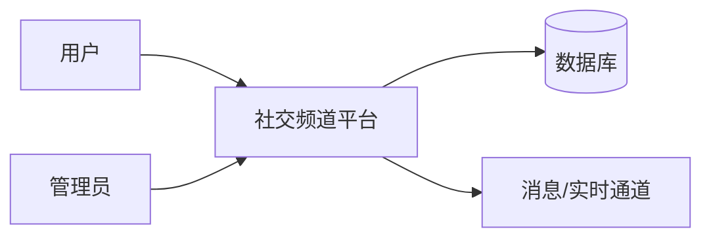

# 架构设计

> 状态：**草案**。架构确认回答（技术栈、部署、规模）后由本文件定稿，并补充对应 ADR。
> 每一次架构层面的调整都必须更新本文件并新增/更新 ADR，不允许只改代码。

## 1. 架构目标与约束

### 1.1 业务目标（待需求确认）

- 【待定】平台定位与核心价值
- 【待定】目标用户与核心使用场景

### 1.2 非功能目标（待确认后量化）

| 维度 | 目标 | 说明 |
| --- | --- | --- |
| 规模 | 待定 | 初期 DAU / 峰值并发 / 频道数 / 消息量 |
| 实时性 | 待定 | 消息延迟目标（如 p95 < 500ms） |
| 可用性 | 待定 | 如 99.9% / 单机可接受 |
| 性能 | 待定 | 读 p95 / 写 p95 目标 |
| 安全合规 | 待定 | 个人信息保护、内容合规要求 |
| 运维复杂度 | 待定 | 是否允许容器编排、是否需要多环境 |

### 1.3 技术约束

- 【待定】团队技术栈熟悉度与偏好
- 【待定】部署环境（本机 / 云主机 / 托管平台 / 私有化）
- 【待定】预算限制（服务器、第三方服务）

## 2. 系统上下文（C4 L1）

> 待架构确认后补充：外部参与者（Web 用户、移动端、管理端、第三方服务）与系统边界。

## 3. 技术选型

| 层 | 选型 | 版本 | 理由 | ADR |
| --- | --- | --- | --- | --- |
| 前端 | 待定 | — | — | — |
| 后端 | 待定 | — | — | — |
| 数据库 | 待定 | — | — | — |
| 缓存 / 队列 | 待定 | — | — | — |
| 实时通信 | 待定 | — | — | — |
| 认证 | 待定 | — | — | — |
| 部署 | 待定 | — | — | — |
| 可观测性 | 待定 | — | — | — |

> 选型一旦确认，必须创建 ADR（背景、候选方案、决策、后果），并在此处链接。

## 4. 模块划分（C4 L2）

> 待定。原则：按业务领域划分，依赖单向，模块可独立测试。

| 模块 | 职责 | 对外接口 | 依赖 |
| --- | --- | --- | --- |
| 身份与账号 | 注册、登录、会话、资料 | — | — |
| 频道 | 频道创建、设置、成员管理 | — | — |
| 内容 | 帖子/消息的发布、编辑、删除 | — | — |
| 实时 | WebSocket 连接、消息推送、在线状态 | — | — |
| 通知 | 站内通知、提醒 | — | — |
| 搜索 | 内容/成员搜索 | — | — |
| 审核与治理 | 举报、屏蔽、审核队列 | — | — |
| 管理后台 | 运营管理、数据统计 | — | — |

## 5. 数据架构

> 待定：核心实体关系（ER）、主库/缓存划分、一致性策略、数据保留与清理策略。

## 6. 实时通信架构

> 待定：连接层与业务层分离方式、消息扇出模型、离线补偿、多实例下的房间/频道广播方案。

## 7. 安全架构

> 待定：认证方式、会话管理、权限模型（RBAC/ABAC）、越权防护、密钥管理。
> 权限矩阵与威胁模型最终写入 `docs/07-安全与合规.md`。

## 8. 部署拓扑

> 待定：环境划分、网络边界、反向代理、TLS、数据库与存储、备份、日志与监控部署位置。

## 9. 关键流程

> 待定（每张时序图对应一个核心用例，如：注册登录、加入频道、发送消息、内容举报处置）。

## 10. 架构决策索引

| ADR | 决策 | 状态 |
| --- | --- | --- |
| [ADR-0001](adr/ADR-0001-采用文档驱动的文档体系.md) | 采用文档驱动与分层文档体系（工程基线） | accepted |

## 11. 非目标与未来演进

> 待定：本期明确不做的事情（避免范围蔓延），以及可预见的演进方向（多端、多租户、国际化等）。

## 12. 开放问题

> 记录尚未决策、可能影响架构的问题，逐条跟踪至关闭。

| # | 问题 | 影响 | 状态 |
| --- | --- | --- | --- |
| 1 | 待架构确认 | — | open |
