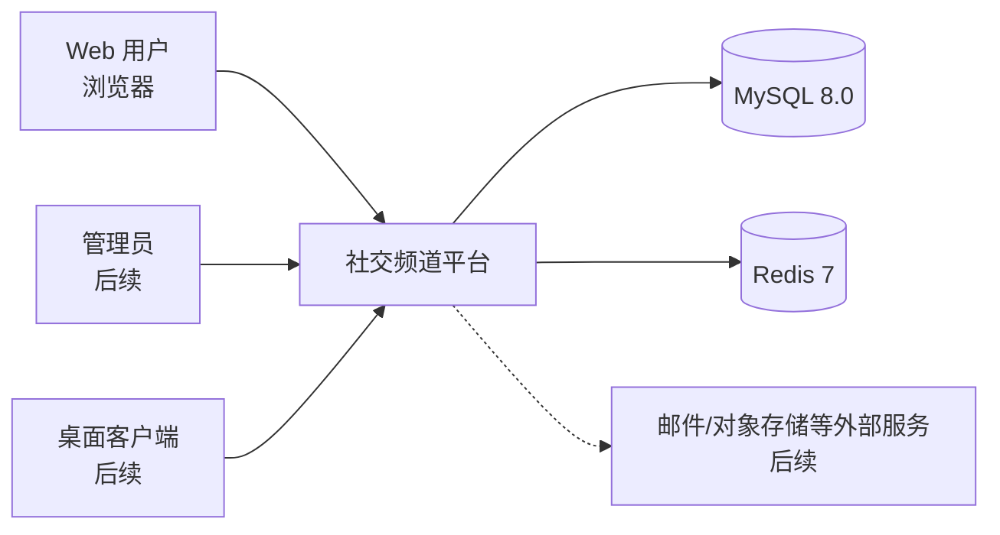
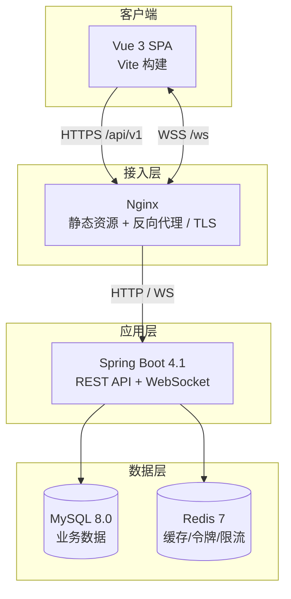
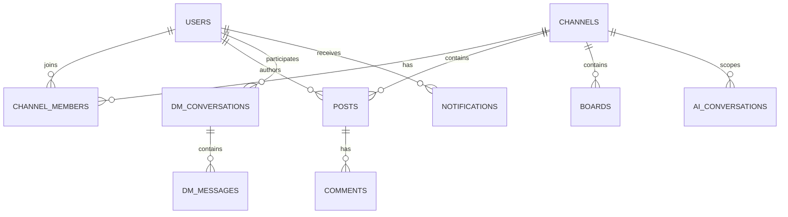
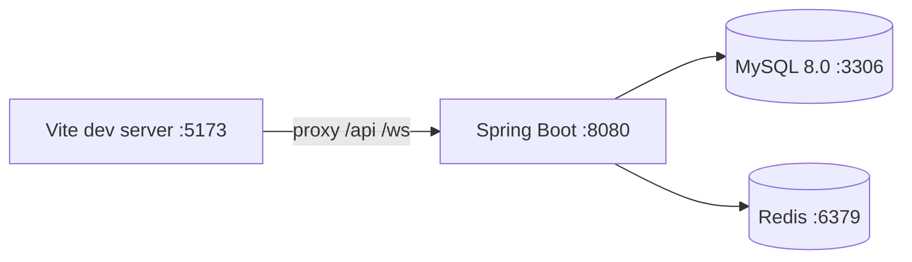
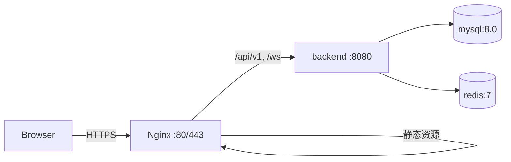
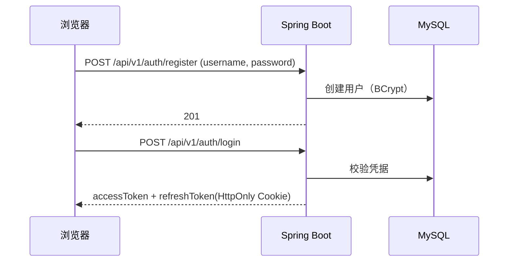
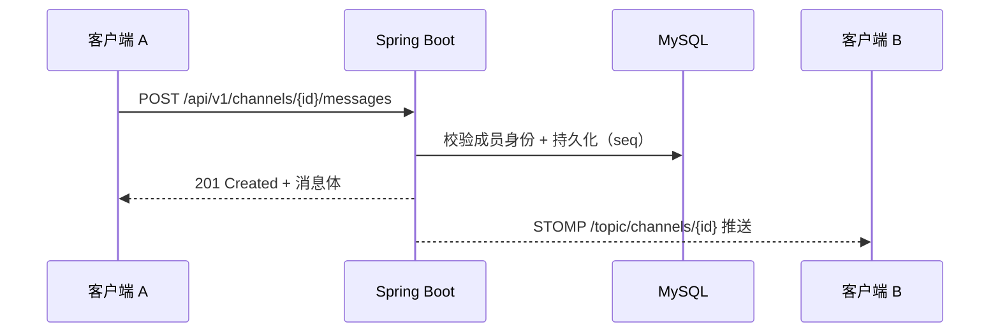

# 架构设计

> 状态：**评审中（待负责人确认）**。确认后状态改为 `approved`，作为开发依据。
> 架构调整必须更新本文件并新增/更新 ADR（见 [ADR 索引](adr/README.md)），不允许只改代码。

## 1. 架构目标与约束

### 1.1 业务目标

- 建设一个**社交频道平台**：用户可创建/加入频道，在频道内发布内容并进行实时交流。
- 首批形态：**Web 优先（响应式）**；Web 成熟后部署到自有服务器，并考虑桌面客户端。
- 具体功能范围以 [需求规格](03-需求规格.md) 为准（需求确认后填充）。

### 1.2 非功能目标

| 维度 | 目标（v1 基线） | 说明 |
| --- | --- | --- |
| 规模 | 按**小型社区**设计（1k–1 万 DAU），架构保留水平扩展点 | 初期用户量未定，不为超大规模过度设计 |
| 实时性 | 频道内消息推送 p95 ≤ 500 ms | WebSocket + STOMP |
| 性能 | 读 API p95 ≤ 200 ms、写 API p95 ≤ 300 ms | 单实例基线，超出优化 |
| 可用性 | 单实例部署，可接受分钟级维护窗口 | Docker Compose 单机 |
| 安全合规 | 认证授权、输入校验、密钥外置、个人信息最小化 | 见 §6.3 |
| 运维复杂度 | 单人可维护；一条命令启动本地环境、一条命令部署 | 模块化单体，拒绝微服务 |

### 1.3 技术约束（已实测）

| 约束 | 内容 |
| --- | --- |
| 技术偏好 | 用户选定：Spring Boot + Vue、MySQL + Redis、WebSocket 实时、Docker Compose 部署 |
| 本机环境 | JDK 17.0.12（`JAVA_HOME`）、Maven 3.9.4、MySQL 8.0.45（本机服务运行中）、Node 26.7.0、pnpm 11.24.0 |
| 环境缺口 | 本机未安装 Docker 与 Redis：开发期用 Memurai（Redis 7 兼容）或本地 Redis；Docker Compose 部署文件在服务器上验证 |
| 构建验证 | Spring Boot 4.1.2 + Java 17 + MyBatis-Plus 3.5.18 依赖组合已通过 `mvn compile` 验证 |
| 协作方式 | 单人 + AI 辅助开发，规范见 [工程开发规范](00-工程开发规范.md) |

## 2. 系统上下文（C4 L1）



- 系统边界：平台负责账号、频道、内容、实时消息、通知与治理；邮件、对象存储、短信等通过适配器接入，后续按需引入。
- 多端策略：Web 与桌面客户端复用同一套 REST + WebSocket 接口，不引入 BFF。

## 3. 总体架构



- **模块化单体**：单个 Spring Boot 应用，按业务领域分包；不引入消息队列与微服务（规模不需要）。
- **前后端分离**：Vue SPA 通过 REST 获取数据、通过 STOMP over WebSocket 接收实时事件。
- **写路径优先走 REST**：消息/内容先经 API 持久化，再通过 WebSocket 广播；WS 只做下行推送，避免丢失与顺序问题。
- **单机部署**：Nginx + Spring Boot + MySQL + Redis 四个容器；后续扩展多实例时，前端不变，后端增加 Redis Pub/Sub 广播与负载均衡。

## 4. 技术选型

| 层 | 选型 | 版本基线 | 理由 | ADR |
| --- | --- | --- | --- | --- |
| 语言（后端） | Java | 17（LTS，`JAVA_HOME`） | 长期支持、本机就绪、生态成熟 | [ADR-0002](adr/ADR-0002-技术栈选型.md) |
| 后端框架 | Spring Boot | 4.1.2 | 当前稳定版，内置 Web/安全/校验/Actuator | ADR-0002 |
| 构建（后端） | Maven | 3.9.4 | 本机已装，单模块足够 | ADR-0002 |
| 前端框架 | Vue 3 + TypeScript | 3.5.x | 组合式 API、类型安全、用户选型 | ADR-0002 |
| 前端构建 | Vite + pnpm | 8.x / 11.x | 冷启动快、生态标准 | ADR-0002 |
| UI 组件库 | Element Plus | 2.14.x | 组件齐全、中文文档、可按需引入 | ADR-0002 |
| 状态/路由 | Pinia + Vue Router | 3.x / 4.x | Vue 官方生态 | ADR-0002 |
| HTTP 客户端 | Axios | 1.x | 拦截器统一鉴权与错误处理 | — |
| 实时通信 | Spring WebSocket + STOMP | Boot 管理 | 官方支持、与安全/心跳集成好 | [ADR-0003](adr/ADR-0003-实时通信方案.md) |
| 实时客户端 | @stomp/stompjs | 7.x | STOMP 协议标准实现 | ADR-0003 |
| 安全框架 | Spring Security + JWT（jjwt） | Boot 管理 / 0.13.0 | 过滤器链 + 无状态令牌 | ADR-0002 |
| 数据访问 | MyBatis-Plus | 3.5.18（boot4 starter） | CRUD 提效 + SQL 可控 | [ADR-0004](adr/ADR-0004-数据访问与迁移方案.md) |
| 数据库 | MySQL | 8.0（utf8mb4） | 用户选型，本机已运行 | ADR-0004 |
| 数据库迁移 | Flyway | Boot 管理 | 迁移只追加、可审计 | ADR-0004 |
| 缓存 | Redis | 7.x（本地 Memurai） | 用户选型；缓存/令牌/限流/后续 Pub-Sub | ADR-0004 |
| 参数校验 | Jakarta Validation | Boot 管理 | 统一输入校验 | — |
| 测试 | JUnit 5 + Spring Boot Test / Vitest | — | 单元 + 集成；前端组件测试 | STD-00 §6 |
| 部署 | Docker Compose + Nginx | — | 用户选型，单机自托管 | ADR-0002 |

> 版本以 `pom.xml` / `package.json` 锁定为准；升级依赖按规范 §14 执行。

## 5. 后端架构

### 5.1 分层与包结构

按**业务领域分包**（package-by-feature），领域内再分层：

```
backend/src/main/java/com/isles/
├── IslesApplication.java
├── common/            # 统一错误、分页、工具、常量、当前用户上下文
├── config/            # Security / WebSocket / CORS / MyBatis-Plus / Redis / Jackson
├── auth/              # 注册、登录、刷新令牌、登出
├── user/              # 用户资料、用户卡片、好友关系
├── channel/           # 频道、成员、身份组、板块、邀请链接、加入审批
├── post/              # 帖子、长文、媒体引用、置顶/精华
├── comment/           # 评论、回复、评论点赞
├── interaction/       # 点赞、浏览、分享、举报
├── feed/              # 频道动态、热门讨论、频道推荐
├── search/            # 全站/频道内搜索、历史、联想、热词
├── dm/                # 私信会话与消息
├── notification/      # 互动消息、系统消息、实时推送
├── ai/                # 频道问问、频道助手、模型配置、AI 会话
├── manage/            # 频道管理中心（资料/内容/成员/日志/数据）
├── analytics/         # 数据统计聚合与数据中心
├── media/             # 上传、校验、缩略图、存储适配
├── admin/             # 平台管理后台（M3）
└── realtime/          # STOMP 配置、订阅鉴权、事件广播
```

每个领域内部统一结构：`controller/`、`service/`、`mapper/`、`entity/`、`dto/`。
依赖方向单向：controller → service → mapper；跨领域只调用对方 service 的公开方法。

### 5.2 接口约定

- REST 风格，前缀 `/api/v1`；资源命名与状态码遵循 [工程开发规范 §7](00-工程开发规范.md)。
- 成功：HTTP 2xx + 资源 JSON（列表为 `{ "items": [...], "nextCursor": "..." }` 或 `{ "items": [...], "total": n }`）。
- 失败：统一错误信封 `{ "error": { "code", "message", "details", "requestId" } }`；错误码为稳定枚举。
- 分页：动态流/消息流用游标分页；管理类列表用偏移分页（`page`、`size`，`size` ≤ 100）。
- 每个请求生成 `requestId`（响应头 `X-Request-Id`），并写入日志 MDC。
- 契约先行的 OpenAPI 文档随接口开发同步维护（`docs/05-API设计.md`）。

### 5.3 认证与授权

- 登录：`username` + 密码（首版）；`email` 字段预留，后续扩展邮箱/第三方登录。
- 令牌：JWT access token（15 分钟，内存保存）+ refresh token（7 天，HttpOnly + Secure + SameSite=Lax Cookie，服务端存哈希可撤销）。
- 密码：BCrypt（cost ≥ 12）；登录与注册接口限流。
- 授权：服务端逐资源校验。平台角色 `USER` / `ADMIN`；频道角色 `OWNER` / `ADMIN` / `MEMBER`，权限矩阵在 `docs/07-安全与合规.md` 文档化并有测试覆盖。
- 无状态 API：JWT 走 `Authorization: Bearer`，不依赖服务端 Session；登出通过撤销 refresh token 实现。
- 游客访问：公开只读接口（频道/帖子/评论/搜索）允许匿名访问；写接口一律要求登录。频道可见性（公开/私密）在服务端强制校验。

### 5.4 实时通信设计

- 端点：`/ws`（原生 WebSocket，不启用 SockJS）；STOMP 协议。
- 连接鉴权：STOMP `CONNECT` 帧携带 `Authorization: Bearer <accessToken>`，`ChannelInterceptor` 校验后绑定 Principal，失败断开。
- 订阅：`/topic/channels/{channelId}`（频道内事件，订阅前校验成员身份）、`/user/queue/notifications`（个人通知）、`/user/queue/dm`（私信）。
- 写路径：发帖、评论、私信等通过 REST 持久化，成功后由服务端 `SimpMessagingTemplate` 广播（通知、私信、频道新帖事件）；客户端收到推送后按 `id`/`seq` 去重，断线重连后通过 REST 按游标补拉。
- 心跳：服务端 10s 发送、客户端 10s 发送（STOMP heartbeat），双端可配置。
- 扩展：多实例时接入 Redis Pub/Sub（Spring Messaging 桥接）实现跨实例广播；v1 单实例不启用。
- 消息上限、背压与顺序遵循 [工程开发规范 §10](00-工程开发规范.md)。

### 5.5 数据访问与迁移

- MyBatis-Plus：BaseMapper 承担常规 CRUD；复杂查询（动态流、搜索、统计）写 XML/注解 SQL，必须参数化并评审。
- 逻辑删除：`deleted_at` 字段 + 全局过滤；唯一索引配合部分条件（MySQL 无部分索引时用冗余列/应用层保证）。
- 分页插件统一分页参数；禁止无界查询。
- Flyway 管理表结构：`backend/src/main/resources/db/migration/V{n}__{描述}.sql`，只追加、不回改；破坏性变更两阶段。
- 本地测试库：`my_social_channel_test`；集成测试使用 `@Transactional` 回滚，保证可重复。

### 5.6 缓存与限流

- Redis 用途：热点数据缓存（频道信息、用户资料）、refresh token/黑名单、接口限流、后续 Pub/Sub。
- 缓存策略：读多写少才缓存，明确 TTL 与写后失效；空值缓存防穿透；热点 key 防击穿。
- 限流：登录/注册/发帖/发消息等写接口按用户 + IP 限流（Redis 计数器/令牌桶），超限返回 429 + `Retry-After`。

### 5.7 日志与可观测性

- SLF4J + Logback；生产 JSON 结构化日志，字段遵循 [规范 §12](00-工程开发规范.md)，含 `traceId`、`requestId`、`userId`（脱敏）。
- Spring Boot Actuator 暴露 `/actuator/health`、`/actuator/metrics`（仅内网/受限），供部署健康检查与后续监控接入。
- 关键业务事件（登录、建频道、入频道、发消息、封禁）记 INFO 级别业务日志。

## 6. 前端架构

### 6.1 目录结构

```
frontend/src/
├── api/           # Axios 实例、拦截器、按领域拆分的接口封装
├── assets/        # 静态资源
├── components/    # 跨页面通用组件
├── composables/   # 组合式逻辑（useAuth、useSocket、usePagination…）
├── layouts/       # 页面布局（登录页/主布局/管理布局）
├── pages/         # 路由页面，按业务域组织
├── router/        # 路由与守卫
├── stores/        # Pinia stores
├── styles/        # 全局样式、Design Token、Element Plus 主题
├── types/         # 共享类型与 API 类型
└── utils/         # 工具函数
```

### 6.2 状态与数据流

- 服务端数据：页面级请求 + 轻量缓存；Pinia 只存放跨页面共享状态（当前用户、令牌、全局 UI 状态）。
- 鉴权：access token 存内存（Pinia），刷新令牌由 HttpOnly Cookie 持有；Axios 拦截器自动附加令牌并在 401 时尝试刷新一次。
- 错误处理：拦截器统一解析错误信封并提示；页面必须实现加载/空/错误三态。

### 6.3 路由与权限

- 路由守卫：未登录访问需鉴权页面跳转登录；已登录访问登录页跳回首页。
- 频道角色权限在前端做展示层控制（隐藏按钮），**最终以服务端校验为准**。

### 6.4 UI 与样式

- Element Plus 按需引入；通过 CSS 变量覆盖主题，颜色/间距/字号统一在 `styles/tokens.css` 定义。
- 响应式断点：移动优先，≥ 768px / ≥ 1024px 两档增强。

### 6.5 实时客户端

- `@stomp/stompjs` 封装为 `useSocket`：连接、重连（指数退避 + 抖动）、订阅管理、页面卸载清理。
- 鉴权令牌通过 CONNECT headers 传递；重连成功后重新订阅并按游标补拉消息。

## 7. 数据架构（草案，需求确认后定稿）



| 数据域 | 表（草案） | 说明 |
| --- | --- | --- |
| 账号 | `users`、`refresh_tokens` | 账号、资料、令牌 |
| 频道 | `channels`、`channel_members`、`roles`、`boards`、`channel_invites`、`join_requests` | 频道、成员、身份组、板块、邀请与审批 |
| 内容 | `posts`、`post_media`、`comments`、`post_likes`、`comment_likes` | 帖子、媒体、评论、点赞 |
| 社交 | `friend_relations`、`dm_conversations`、`dm_messages` | 双向好友、私信（含拉黑/免打扰） |
| 通知 | `notifications` | 互动消息 / 系统消息 |
| 搜索 | `search_history`、`search_logs`、`hot_keywords` | 历史、日志、热词聚合 |
| AI | `ai_model_configs`、`ai_conversations`、`ai_messages`、`channel_ai_settings`、`ai_task_logs` | 模型配置、会话、助手设置、任务 |
| 治理 | `reports`、`audit_logs` | 举报、管理日志 |
| 统计 | `daily_channel_stats` | 数据中心日聚合 |

> 最终表结构、索引与字段以 `docs/06-数据库设计.md` + Flyway 迁移为准；需求确认后补充评论媒体、板块权限等细节。
> 需求明确：频道内以"帖子 + 评论"承载内容，**没有频道群聊实时消息**；实时通道用于私信、通知与事件推送。

## 8. 部署与运行

### 8.1 本地开发环境



| 组件 | 本地方式 | 端口 |
| --- | --- | --- |
| 后端 | `mvn spring-boot:run`（`JAVA_HOME` 指向 JDK 17） | 8080 |
| 前端 | `pnpm dev` | 5173（代理到 8080） |
| MySQL | 本机 MySQL 8.0 服务，数据库 `my_social_channel` | 3306 |
| Redis | Memurai / Redis 7 本地实例 | 6379 |

### 8.2 生产部署（Docker Compose）



- 容器：`nginx`（前端静态资源 + 反向代理 + TLS 终止）、`backend`（Spring Boot JRE 镜像）、`mysql`、`redis`。
- 数据卷：MySQL 数据、Redis 数据（可选持久化）、上传文件目录。
- 配置与密钥通过 `.env` 注入，禁止写入镜像；健康检查接入 Actuator。
- 发布流程按 [发布检查清单](templates/发布检查清单.md) 执行；数据库迁移在容器启动前脚本化执行（Flyway 随应用启动）。
- 本机无 Docker，Compose 文件编写后需在云服务器或安装 Docker 后验证；未验证前不得声称"已部署"。

### 8.3 环境与配置

| 环境 | 用途 | 配置来源 |
| --- | --- | --- |
| local | 本机开发 | `application-local.yml` + 环境变量 |
| prod | 生产 | 环境变量 + `.env`（不入库） |

- 统一 UTC 存储；JDBC 连接显式设置时区；前端按浏览器时区展示。
- 配置项缺失或非法时应用启动失败（fail fast）。

## 9. 关键流程

### 9.1 注册 / 登录



### 9.2 发送频道消息



## 10. 非目标与演进

- **非目标（v1）**：微服务拆分、服务端渲染（SSR）、原生移动 App、多租户、完整国际化、分布式事务。
- **保留扩展点**：
  - 桌面客户端：复用 REST/WS，未来用 Tauri/Electron 封装 Web 前端。
  - 多实例：后端无状态 + Redis Pub/Sub + 负载均衡。
  - 搜索：初期 MySQL 全文/前缀查询，规模增长后接专门检索引擎。
  - 对象存储：媒体文件从本地磁盘切换为对象存储（适配器模式）。
  - 国际化：前端文案统一走 i18n key，预留多语言文件。

## 11. 架构决策索引

| ADR | 决策 | 状态 |
| --- | --- | --- |
| [ADR-0001](adr/ADR-0001-采用文档驱动的文档体系.md) | 采用文档驱动与分层文档体系 | accepted |
| [ADR-0002](adr/ADR-0002-技术栈选型.md) | Spring Boot 4.1.2 + Vue 3 技术栈 | accepted |
| [ADR-0003](adr/ADR-0003-实时通信方案.md) | STOMP over WebSocket | accepted |
| [ADR-0004](adr/ADR-0004-数据访问与迁移方案.md) | MySQL 8 + MyBatis-Plus + Flyway | accepted |
| [ADR-0005](adr/ADR-0005-频道类型与邀请机制.md) | 频道类型与邀请机制（公开 + 私密邀请） | accepted |

## 12. 开放问题

| # | 问题 | 影响 | 状态 |
| --- | --- | --- | --- |
| 1 | 首批功能范围与分期（P0/P1/P2） | 排期与模块优先级 | resolved：三期交付已确认（见 `REQ-03` §10） |
| 2 | 平台管理后台范围 | `admin` 模块 | resolved：M3 |
| 3 | 内容模型：频道帖子 / 评论 / 私信的关系 | 表结构与实时推送设计 | resolved：频道内为帖子+评论，无群聊 |
| 4 | 媒体文件存储 | 部署与容量 | resolved：M1–M2 本地磁盘，预留对象存储接口 |
| 5 | 内容审核强度与合规要求 | 审核模块与流程 | M1–M2 以举报+人工为主，策略后置 |
| 6 | 好友关系模型与私信权限 | `dm`/`user` 模块与表结构 | resolved：双向好友 + 任何人可私信（可拉黑） |
| 7 | 搜索实现：MySQL 全文/前缀 vs 外部引擎 | 搜索性能与运维 | 先用 MySQL，数据量增长后升级 |
| 8 | 桌面客户端与服务器租用时间点 | 多端适配与部署计划 | 后续，非阻塞 |
| 9 | 频道类型与邀请机制 | 频道模型与加入流程 | resolved：见 [ADR-0005](adr/ADR-0005-频道类型与邀请机制.md) |
| 10 | 频道助手自动运营的内容与频率 | `ai` 任务设计 | M3 细化 |

## 13. 变更记录

| 日期 | 版本 | 变更 | 原因 |
| --- | --- | --- | --- |
| 2026-11-14 | 0.1.0 | 创建架构文档骨架 | 架构待确认 |
| 2026-11-14 | 0.2.0 | 确认技术栈、实时通信、数据访问方案，补充模块/部署/流程设计 | 用户确认架构方向 |
| 2026-11-14 | 0.3.0 | 按需求分析扩充模块划分（评论/互动/搜索/私信/AI/管理中心/统计）、更新数据域与实时通道用途 | 负责人提供初步需求 |
| 2026-11-14 | 0.4.0 | 更新包名 com.isles、频道邀请/审批与好友数据域、游客访问规则；同步需求确认决策 | 需求决策确认 |
