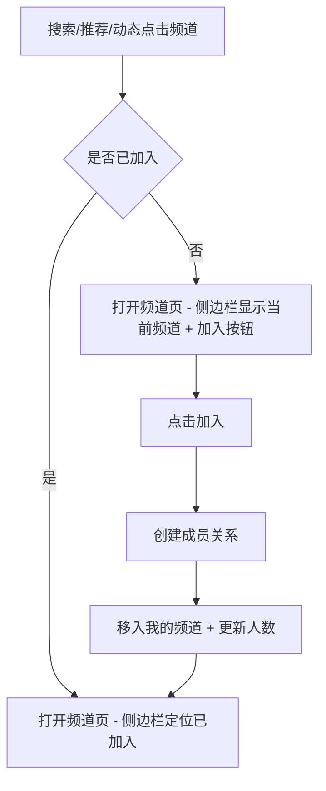
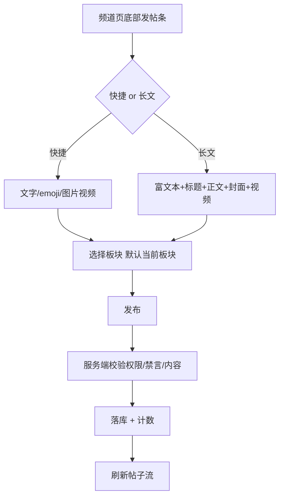
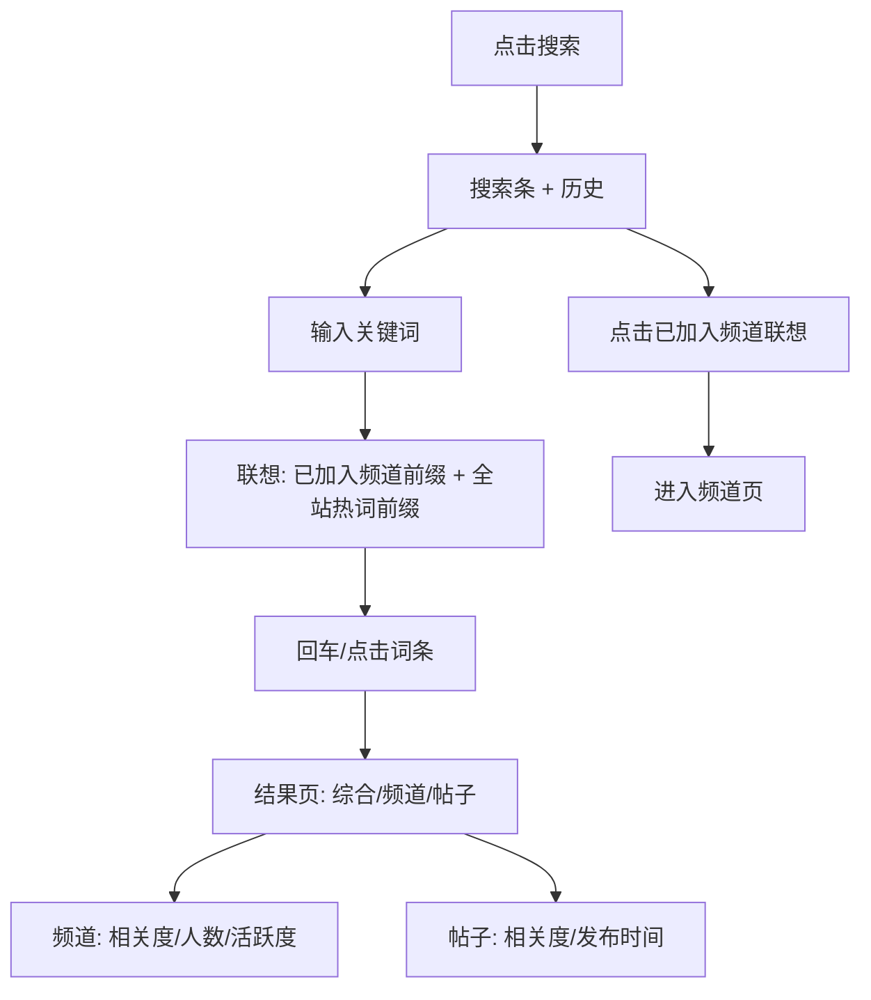
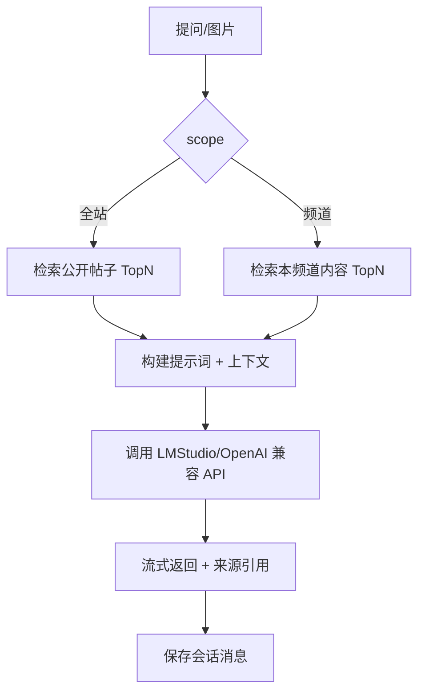

# 需求规格

> 依据项目负责人口述需求整理。竞品参考：**腾讯频道**。
> 本文是需求基线：包含功能清单、信息架构、通用模块复用设计、数据模型草案、数据中心设计、交付范围与需求决策记录。
> 关键决策已与负责人确认（见 §11）；2026-11-14 起取消分期，改为**全量交付**。本文作为开发依据。

## 1. 产品概述

### 1.1 定位

**产品名：群岛（英文 Isles）** —— 每个频道是一座岛，用户在各岛之间漫游、发现同频的人。

一个以**频道**为组织单元的社区平台：用户可以创建/加入频道，在频道内发布帖子、评论与互动；平台提供全站内容发现（动态、热门讨论、搜索、推荐）与 AI 能力（频道问问、频道助手）；频道主/管理员通过**频道管理中心**运营频道。

### 1.2 竞品参考

- 腾讯频道：频道化内容社区、帖子流、热门内容、频道管理、AI 问答等能力。
- 差异点：AI 深度集成（频道问问 + 频道助手自动运营）、LMStudio 本地模型、群岛式频道发现（频道推荐）。

### 1.3 目标用户（初步）

从示例（已加入 VRChat 频道）推断，目标用户为 ACG / 虚拟社区 / 兴趣圈层用户；
具体用户画像与首批种子频道方向待运营确认。

### 1.4 核心价值

1. **频道即圈子**：创建/加入频道，沉淀帖子、评论与互动。
2. **发现内容**：频道动态（已加入）、热门讨论（全站）、搜索、频道推荐。
3. **AI 增强**：频道问问（基于全站公开帖子的问答）、频道助手（频道内问答 + 自动运营）。

### 1.5 术语

见 [领域模型与词汇表](04-领域模型与词汇表.md)。核心术语：平台、用户、频道、板块、帖子、评论、身份组、频道号、动态、热门、精华、置顶、私信、通知、频道问问、频道助手。

## 2. 角色与权限

### 2.1 角色定义

| 角色 | 范围 | 说明 |
| --- | --- | --- |
| 游客 | 全站 | 未登录可浏览公开频道、公开帖子、评论与公开搜索结果；点赞/评论/发帖/私信需登录 |
| 注册用户 | 全站 | 可加入频道、发帖、评论、私信等 |
| 频道成员 | 单频道 | 默认身份组：普通成员 |
| 子板块管理员 | 单频道 / 单板块 | 管理指定板块的内容与成员互动 |
| 超级管理员 | 单频道 | 频道主之外的最高管理角色 |
| 频道主 | 单频道 | 频道创建者，拥有全部权限（唯一） |
| 平台管理员 | 全站 | 平台运营与内容治理；管理后台在 M3 建设 |
| AI 助手账号 | 单频道 | 由频道助手设置生成的虚拟账号（频道主可配置） |

### 2.2 权限模型（草案）

- **身份组（Role）** = 权限点集合 + 适用范围；频道默认四个身份组：频道主、超级管理员、子板块管理员、普通成员。
- 频道主可在"成员管理"中**新建自定义身份组**并勾选权限点，再分配给成员。
- 子板块管理员权限可限定到具体板块（`scope_board_id`），其余身份组为频道级。
- 权限点（草案，开发前在 `docs/07-安全与合规.md` 定稿）：

| 权限点 | 说明 |
| --- | --- |
| `post.create` | 发帖 |
| `comment.create` | 评论/回复 |
| `post.pin` / `post.essence` | 置顶 / 加精 |
| `post.delete` / `comment.delete` | 删除帖子 / 评论 |
| `channel.settings` | 修改频道资料（名称/头像/封面/简介） |
| `channel.member.invite` | 邀请成员 |
| `channel.member.remove` | 移除成员 |
| `channel.member.mute` | 禁言成员 |
| `channel.mute_all` | 全员禁言 |
| `channel.role.manage` | 身份组管理 |
| `channel.invite.create` | 生成/管理邀请链接 |
| `channel.invite.approve` | 审批加入申请 |
| `channel.visibility` | 修改频道可见性 |
| `channel.board.manage` | 板块管理 |
| `channel.content.manage` | 内容管理 |
| `channel.log.view` | 管理日志 |
| `channel.data.view` | 数据中心 |
| `channel.ai.manage` | 频道助手设置 |
| `channel.dissolve` | 解散频道（仅频道主） |

### 2.3 权限矩阵（草案，待 `07` 定稿）

| 能力 | 频道主 | 超级管理员 | 子板块管理员 | 普通成员 |
| --- | --- | --- | --- | --- |
| 发帖 / 评论 | ✅ | ✅ | ✅（本板块） | ✅ |
| 置顶 / 精华 | ✅ | ✅ | ✅（本板块） | ❌ |
| 删帖 / 删评论 | ✅ | ✅ | ✅（本板块） | ❌ |
| 频道资料 | ✅ | ✅ | ❌ | ❌ |
| 成员管理（邀请/移除/禁言） | ✅ | ✅ | ❌ | ❌ |
| 邀请链接与审批 | ✅ | ✅ | ❌ | ❌ |
| 身份组管理 | ✅ | ✅（不可超过自身） | ❌ | ❌ |
| 全员禁言 | ✅ | ✅ | ❌ | ❌ |
| 内容管理 / 管理日志 / 数据中心 | ✅ | ✅ | 仅本板块内容 | ❌ |
| 频道助手设置 | ✅ | ✅ | ❌ | ❌ |
| 解散频道 | ✅ | ❌ | ❌ | ❌ |

## 3. 信息架构与导航

### 3.1 全局布局

- **左侧固定侧边栏**（自上而下）：
  1. 平台名/Logo（点击回默认首页）
  2. 搜索
  3. 频道问问
  4. 频道动态
  5. 热门讨论
  6. 我的频道（右侧"+"号 → 创建频道入口；下方展开已加入频道列表）
  7. 当前频道位置（**仅查看未加入频道的频道内容时显示**）
  8. 我的私信（下方展开会话列表，类 QQ）
  9. 底部固定：当前用户头像、用户名、签名
- **右侧大容器**：点击侧边栏任意板块，在右侧展示对应页面；选中态高亮。
- 默认首页内容：频道动态【假设，待确认】。
- 侧边栏整体可折叠【P2，可选】。

### 3.2 页面/路由清单（草案）

| 路由 | 页面 | 入口 |
| --- | --- | --- |
| `/` | 首页（默认：频道动态） | 平台名 / 登录后 |
| `/feed` | 频道动态 | 侧边栏 |
| `/hot` | 热门讨论 | 侧边栏 |
| `/ai` | 频道问问（AI 问答，含会话侧栏） | 侧边栏 |
| `/channels/:id` | 频道页（已加入/未加入共用） | 我的频道、动态、热门、搜索、推荐、当前频道 |
| `/posts/:id` | 帖子详情 | 帖子卡片、置顶帖子 |
| `/search?q=` | 搜索结果页 | 搜索 |
| `/messages` | 私信会话列表 | 侧边栏 |
| `/messages/:id` | 私信聊天窗 | 私信列表、用户卡片 |
| `/manage/:channelId/*` | 频道管理中心（首页/资料/内容/数据/日志/助手/成员/创建频道） | 频道设置→频道管理 |
| `/admin/*` | 平台管理后台（M3） | 平台管理员入口 |

### 3.3 导航行为规则

- 点击帖子 → 打开**帖子详情页**；采用应用内路由跳转，浏览器可返回。
- 点击频道名/频道头像 → 打开**频道页**；同样走应用内路由。
- 点击用户头像/用户名 → 弹出**用户卡片浮层**（不跳转页面）。
- 从搜索/推荐进入未加入频道 → 侧边栏显示"当前频道"，并高亮；加入后合并到"我的频道"并定位高亮。
- 浏览器返回：按 SPA 历史返回上一个内容页（侧边栏状态同步恢复）。

## 4. 功能需求

> 优先级：**P0** = 第一个可运行版本（M1）；**P1** = 管理/运营阶段（M2）；**P2** = 智能/增长阶段（M3+）。
> 优先级保留 P0/P1/P2 用于排内部实现顺序；交付策略已改为全量交付（见 §10）。

### 4.1 账号与个人资料（AUTH / USER）

| ID | 功能 | 规则/说明 | 优先级 |
| --- | --- | --- | --- |
| FR-AUTH-01 | 用户注册 | 用户名 + 密码（邮箱字段预留，后续扩展）；用户名唯一、3–20 字符；密码强度校验 | P0 |
| FR-AUTH-02 | 登录 / 登出 | JWT access + refresh（HttpOnly Cookie）；登录失败限流 | P0 |
| FR-AUTH-03 | 当前用户信息 | 头像、用户名、签名、性别、地区、ID；启动时获取 | P0 |
| FR-AUTH-04 | 游客浏览 | 未登录可浏览公开频道、帖子、评论与搜索结果；互动操作需登录；私密频道不可见 | P0 |
| FR-USER-01 | 个人资料编辑 | 头像、签名、性别、地区；用户名修改【待确认】 | P0（基础）/P1（完整） |
| FR-USER-02 | 用户卡片浮层 | 头像、用户名、性别、地区、加入当前频道的时间、身份组、私信按钮、加好友按钮 | P0（展示）/P1（私信、加好友） |
| FR-USER-03 | 我的私信入口 | 侧边栏"我的私信"展开会话列表 | P1 |
| FR-USER-04 | 用户主页 | 【待确认】是否需要完整个人主页（帖子/动态列表） | P2 |
| FR-USER-05 | 好友关系 | 双向好友：申请、同意、删除、好友列表；被拉黑不可发起好友/私信 | P1 |

### 4.2 全局导航（NAV）

| ID | 功能 | 规则/说明 | 优先级 |
| --- | --- | --- | --- |
| FR-NAV-01 | 侧边栏框架 | 固定左侧，条目见 §3.1；右侧容器切换内容 | P0 |
| FR-NAV-02 | 频道定位 | 进入频道页时侧边栏高亮/滚动定位；未加入频道显示"当前频道"项 | P0 |
| FR-NAV-03 | 底部个人区 | 固定显示头像、用户名、签名；点击进入个人设置 | P0 |
| FR-NAV-04 | 侧边栏折叠 | 可折叠为图标模式（可选） | P2 |

### 4.3 频道（CHANNEL）

| ID | 功能 | 规则/说明 | 优先级 |
| --- | --- | --- | --- |
| FR-CH-01 | 创建频道 | 弹窗：频道名、头像、简介、频道类型；创建成功提示"复杂设置请前往管理中心" | P0 |
| FR-CH-02 | 频道页 | 已加入/未加入共用同一视图；未加入显示"加入频道"按钮 | P0 |
| FR-CH-03 | 频道头部 | 头像、频道名、背景图（向下滚动时渐隐/收起）；右侧图标：搜索、消息、频道设置 | P0 |
| FR-CH-04 | 频道标签页 | 全部（按发布时间）、热门（点赞/浏览量）、精华（管理员设置）、其他子板块 | P0 |
| FR-CH-05 | 置顶区 | 固定展示 1 条置顶标题 + 置顶数量；展开显示全部置顶标题；点击 → 帖子详情 | P0（展示）/P1（设置） |
| FR-CH-06 | 频道帖子流 | 复用帖子卡片（隐藏频道信息，增加"板块"标签） | P0 |
| FR-CH-07 | 频道简介（右侧） | 帖子数量、人数、简介文字 | P0 |
| FR-CH-08 | 发帖条（底部） | 快捷发帖：文字、emoji、图片/视频；"发长文"进入完整编辑器 | P0 |
| FR-CH-09 | 加入频道 | 未加入频道可加入；加入后进入"我的频道"并更新成员数 | P0 |
| FR-CH-10 | 全员禁言 | 频道主/超管可设置禁言时长（预设 + 自定义）；禁言期间仅主/超管可发言；页面展示禁言状态 | P1 |
| FR-CH-11 | 频道设置面板 | 头像、名称、频道号、成员（主/超管 + 邀请链接 + 人数 + 展开搜索）、退出频道、频道管理入口 | P1 |
| FR-CH-12 | 退出 / 解散频道 | 普通成员退出；频道主显示"解散频道"（二次确认） | P1 |
| FR-CH-13 | 频道号 | 频道唯一数字编号，创建时生成，可展示/搜索 | P0 |
| FR-CH-14 | 频道类型 | 公开（自由加入）/ 私密（仅邀请加入）；私密频道可设置可见性（公开可见 / 仅成员可见） | P0 |
| FR-CH-15 | 邀请链接 | 生成邀请链接，可配置是否需审批、有效期、使用次数；审批列表处理 | P0（基础）/P1（管理） |
| FR-CH-16 | 加入审批 | 需审批的邀请链接：用户申请 → 管理员/频道主审批 → 通过后加入；拒绝需可通知 | P1 |

### 4.4 帖子与内容（POST）

| ID | 功能 | 规则/说明 | 优先级 |
| --- | --- | --- | --- |
| FR-POST-01 | 快捷发帖 | 文字 + emoji + 图片/视频；发布到当前板块（默认） | P0 |
| FR-POST-02 | 长文发帖 | 富文本编辑器、标题、正文、封面、视频、选择板块 | P0 |
| FR-POST-03 | 帖子卡片 | 作者头像/名、时间、正文摘要、媒体、点赞/评论/分享/浏览；媒体缩略图；视频默认静音自动播放、可全屏/开声音 | P0 |
| FR-POST-04 | 帖子详情 | 作者 + 角色组标识、精华/置顶标志、举报按钮；标题、正文、媒体、板块、浏览量、发布时间；评论区 | P0 |
| FR-POST-05 | 分享 | 分享给好友（P1）/ 复制链接（P0） | P0 / P1 |
| FR-POST-06 | 精华 / 置顶 | 频道主/超管/板块管理员设置；有标志展示 | P1 |
| FR-POST-07 | 帖子编辑 / 删除 | 作者可编辑/删除；管理员可删除（进入系统消息） | P1 |
| FR-POST-08 | 板块归属 | 每帖必须属于一个板块；频道页按板块筛选 | P0（若板块确认） |

### 4.5 评论（COMMENT）

| ID | 功能 | 规则/说明 | 优先级 |
| --- | --- | --- | --- |
| FR-CMT-01 | 评论列表 | 用户名、头像、时间、身份组；帖子作者评论显示"作者"名牌 | P0 |
| FR-CMT-02 | 评论排序 | 按点赞数 / 最近时间 | P0 |
| FR-CMT-03 | 发表评论 | 文字 + emoji + 图片/视频 | P0 |
| FR-CMT-04 | 回复评论 | 楼中楼；回复对象展示 | P0 |
| FR-CMT-05 | 评论点赞 | 计数与状态 | P0 |
| FR-CMT-06 | 快速评论入口 | 帖子卡片底部展示点赞高的评论 + "查看全部 N 条评论"弹窗 | P0 |
| FR-CMT-07 | 评论删除 | 作者/管理员 | P1 |

### 4.6 互动与内容治理（INTERACTION）

| ID | 功能 | 规则/说明 | 优先级 |
| --- | --- | --- | --- |
| FR-ITR-01 | 点赞 | 帖子/评论点赞，防重复 | P0 |
| FR-ITR-02 | 浏览计数 | 帖子浏览量；防刷策略 P2 | P0 |
| FR-ITR-03 | 举报 | 帖子详情举报按钮；后台/管理中心处置 | P1 |
| FR-ITR-04 | 内容处置通知 | 帖子被系统删除/禁止互动时通知作者（系统消息） | P1 |
| FR-ITR-05 | 敏感内容过滤 | 【待确认】敏感词/审核强度；首期以举报 + 人工为主 | P2 |

### 4.7 频道动态（FEED）

| ID | 功能 | 规则/说明 | 优先级 |
| --- | --- | --- | --- |
| FR-FEED-01 | 动态列表 | 已加入频道的帖子；支持"最新 / 热门"切换 | P0 |
| FR-FEED-02 | 卡片内容 | 频道头像+名、作者头像+名、时间、帖子内容摘要、媒体、点赞/评论/分享、浏览量 | P0 |
| FR-FEED-03 | 跳转行为 | 点频道 → 频道页；点作者 → 用户卡片；点帖子 → 帖子详情 | P0 |
| FR-FEED-04 | 分页 | 游标分页、无限滚动 | P0 |

### 4.8 热门讨论（HOT）

| ID | 功能 | 规则/说明 | 优先级 |
| --- | --- | --- | --- |
| FR-HOT-01 | 全站热门内容 | 与动态相同的卡片逻辑，但范围是全平台 | P1 |
| FR-HOT-02 | 热度排序 | 综合浏览、点赞、评论、时间衰减（算法见 §7） | P1 |
| FR-HOT-03 | 右侧频道推荐 | 频道头像、频道名、推荐理由（加入过类似频道 / 相似用户喜欢 / 新帖多 / 浏览过相似频道） | P2 |
| FR-HOT-04 | 推荐跳转与加入 | 点击进入频道页（未加入显示"当前频道"与加入按钮）；加入后并入我的频道 | P1 |

### 4.9 我的频道（MY CHANNELS）

| ID | 功能 | 规则/说明 | 优先级 |
| --- | --- | --- | --- |
| FR-MYCH-01 | 已加入频道列表 | 侧边栏展开，头像 + 名称；定位高亮 | P0 |
| FR-MYCH-02 | 创建频道入口 | 我的频道右侧"+"；也出现在管理中心侧边栏 | P0 |
| FR-MYCH-03 | 频道管理身份标识 | 我管理的频道在列表中特殊标识【待确认】 | P1 |

### 4.10 搜索（SEARCH）

| ID | 功能 | 规则/说明 | 优先级 |
| --- | --- | --- | --- |
| FR-SRCH-01 | 搜索入口 | 侧边栏搜索；点击右侧显示搜索条 | P0 |
| FR-SRCH-02 | 搜索历史 | 展示历史记录；单条删除、全部清空；仅本人可见 | P0 |
| FR-SRCH-03 | 输入联想 | ① 已加入频道匹配前缀；② 全站高频搜索词按前缀匹配（如输入 "vr" → vr、vrchat、vr资源、vr眼镜） | P1（需搜索日志聚合） |
| FR-SRCH-04 | 联想跳转 | 点击已加入频道 → 频道页 + 侧边栏定位；点击热词/回车 → 结果页 | P0 |
| FR-SRCH-05 | 结果页 | 展示与关键词相关的频道和帖子；Tab：综合 / 频道 / 帖子 | P0（基础）/ P1（完整） |
| FR-SRCH-06 | 频道结果筛选排序 | 按相关度（默认）/ 人数 / 活跃度 | P1 |
| FR-SRCH-07 | 帖子结果筛选排序 | 按相关度（默认）/ 发布时间 | P1 |
| FR-SRCH-08 | 频道内搜索 | 复用搜索组件，范围限定为当前频道 | P1 |
| FR-SRCH-09 | 搜索范围与隐私 | 仅搜索公开频道/公开帖子；私密内容不索引 | P0 |

> 搜索为高投入功能（尤其联想与排序），v1 采用 MySQL 前缀/全文检索 + 搜索日志聚合，后续可升级 Meilisearch/Elasticsearch（见 §9、§11）。

### 4.11 频道问问 AI（AI-QA）

| ID | 功能 | 规则/说明 | 优先级 |
| --- | --- | --- | --- |
| FR-AIQA-01 | 入口与布局 | 侧边栏进入；问答区 + 可收起/展开的右侧会话栏（历史会话 + 新建会话） | P2 |
| FR-AIQA-02 | 模型选择 | 可在已配置模型中选择；显示当前模型 | P2 |
| FR-AIQA-03 | 深度思考开关 | 开启后使用推理模型或增强检索（实现见技术设计） | P2 |
| FR-AIQA-04 | 发送图片 | 支持上传图片（多模态），需配置支持视觉的模型；模型不支持时降级为仅文本 | P2 |
| FR-AIQA-05 | 基于全站公开帖子回答 | 检索相关公开帖子作为上下文；回答附来源引用（建议） | P2 |
| FR-AIQA-06 | 会话管理 | 历史会话持久化、重命名/删除【待确认】、新会话 | P2 |
| FR-AIQA-07 | 重新生成 | 对最后一条回答重新生成 | P2 |
| FR-AIQA-08 | 编辑已发送内容 | 修改历史提问并重新发送，后续消息重新生成 | P2 |
| FR-AIQA-09 | 流式输出 | 打字机式流式返回；可停止生成 | P2 |
| FR-AIQA-10 | AI 配置 | 平台后台配置 LMStudio（OpenAI 兼容地址/模型/密钥）；频道助手共用模型配置 | P2 |

### 4.12 私信（DM）

| ID | 功能 | 规则/说明 | 优先级 |
| --- | --- | --- | --- |
| FR-DM-01 | 会话列表 | 类 QQ：头像、用户名、最后一条消息、时间、未读红点 | P1 |
| FR-DM-02 | 聊天窗口 | 文本、图片、帖子分享；发送/接收实时刷新 | P1 |
| FR-DM-03 | 未读与已读 | 未读数统计，进入会话清零 | P1 |
| FR-DM-04 | 私信权限 | 任意用户可发起私信；支持拉黑与免打扰；被拉黑方不可发送 | P1 |
| FR-DM-05 | 分享帖子 | 从帖子分享给好友（消息中含帖子卡片，可点击跳转） | P1 |

### 4.13 通知与消息中心（NOTIFY）

| ID | 功能 | 规则/说明 | 优先级 |
| --- | --- | --- | --- |
| FR-NTF-01 | 频道互动消息 | 帖子被回复、被点赞等；频道页"消息"按钮查看本频道互动 | P1 |
| FR-NTF-02 | 系统消息 | 帖子被删除、被禁止互动、账号处罚等 | P1 |
| FR-NTF-03 | 已读与跳转 | 未读标识；点击跳转对应帖子/评论 | P1 |
| FR-NTF-04 | 全站通知聚合 | 侧边栏或个人区通知入口【待确认】 | P2 |

### 4.14 频道管理中心（MGR）

| ID | 功能 | 规则/说明 | 优先级 |
| --- | --- | --- | --- |
| FR-MGR-01 | 入口 | 频道设置 → 频道管理（仅主/超管）；独立页面布局 | P1 |
| FR-MGR-02 | 管理侧边栏 | 顶部"当前管理的频道"选择器；首页、频道资料、内容管理、数据中心、管理日志、频道助手设置、成员管理、创建频道 | P1 |
| FR-MGR-03 | 首页概览 | 当前频道成员数、帖子数；昨日数据：成员变动、访问人数、活跃率、新增帖子数 | P1 |
| FR-MGR-04 | 频道资料 | 名称、头像、封面、简介、频道号（可修改项按权限） | P1 |
| FR-MGR-05 | 内容管理 | 列表展示正文/图片视频/发帖人/时间/互动量/操作（置顶、精华）；筛选：关键词、发帖人、板块、时间；批量操作 | P1 |
| FR-MGR-06 | 数据中心 | 见 §8 设计 | P1 |
| FR-MGR-07 | 管理日志 | 频道内所有操作记录（从管理员到普通用户），支持筛选（操作人/类型/时间） | P1 |
| FR-MGR-08 | 频道助手设置 | AI 助手账号配置：昵称、头像、封面、简介、设定描述；任务开关：总结（日报/周报/月度贡献榜）、发帖、评论、点赞 | P2 |
| FR-MGR-09 | 成员管理 | 成员列表（搜索、分页）、身份组新建与管理、分配身份组、禁言/移除 | P1 |
| FR-MGR-10 | 创建频道 | 管理中心侧边栏入口（复用创建频道弹窗） | P1 |

### 4.15 身份组与板块（ROLE / BOARD）

| ID | 功能 | 规则/说明 | 优先级 |
| --- | --- | --- | --- |
| FR-ROLE-01 | 默认身份组 | 频道主、超级管理员、子板块管理员、普通成员，系统内置不可删除 | P1 |
| FR-ROLE-02 | 自定义身份组 | 新建/编辑/删除；勾选权限点；成员分配 | P1 |
| FR-ROLE-03 | 子板块范围 | 子板块管理员权限可绑定具体板块 | P1 |
| FR-BOARD-01 | 板块列表 | 创建频道自动生成默认板块；每帖必须选板块；频道页展示板块标签页 | P0 |
| FR-BOARD-02 | 板块管理 | 管理中心的创建/重命名/排序/删除板块；绑定板块管理员 | P1 |

### 4.16 平台管理后台（PLATFORM-ADMIN，M3）

| ID | 功能 | 规则/说明 | 优先级 |
| --- | --- | --- | --- |
| FR-PADM-01 | AI 配置 | LMStudio/OpenAI 兼容：Base URL、模型列表、密钥、默认模型、连通性测试 | P2 |
| FR-PADM-02 | 内容治理 | 举报处理、帖子/评论下架、用户处罚 | P2 |
| FR-PADM-03 | 平台数据 | 全站用户/频道/内容数据概览 | P2 |

### 4.17 频道助手 AI 运营（ASSIST）

| ID | 功能 | 规则/说明 | 优先级 |
| --- | --- | --- | --- |
| FR-ASSIST-01 | 助手账号 | 频道内虚拟账号：昵称、头像、封面、简介、设定描述 | P2 |
| FR-ASSIST-02 | 频道内问答 | 频道页右侧"频道助手"：基于本频道内容问答；轻量对话界面 + 返回按钮 | P2 |
| FR-ASSIST-03 | 自动总结 | 日报 / 周报 / 月度贡献榜，作为帖子发布 | P2 |
| FR-ASSIST-04 | 自动发帖 | 根据频道热门话题生成互动帖 | P2 |
| FR-ASSIST-05 | 自动评论 / 点赞 | 受频率与权限限制，可配置开关 | P2 |
| FR-ASSIST-06 | 执行日志与开关 | 任务执行记录、失败重试、可随时关闭 | P2 |

### 4.18 媒体与统计（MEDIA / STAT）

| ID | 功能 | 规则/说明 | 优先级 |
| --- | --- | --- | --- |
| FR-MEDIA-01 | 图片上传 | JPG/PNG/WebP/GIF；大小 ≤ 10MB；生成缩略图 | P0 |
| FR-MEDIA-02 | 视频上传 | MP4/WebM；大小 ≤ 200MB；不转码（v1），生成首帧封面（待定） | P0 |
| FR-MEDIA-03 | 播放器 | 静音自动播放、全屏、声音控制 | P0 |
| FR-MEDIA-04 | 存储 | 本地磁盘（v1），预留对象存储接口 | P0 |
| FR-STAT-01 | 统计埋点 | 浏览/点赞/评论/分享/发帖等行为记录（聚合用） | P1 |

## 5. 通用组件与复用设计（模块逻辑核心）

用户强调多处逻辑一致，必须抽象为**可复用组件/服务**，避免多套实现：

### 5.1 前端复用组件

| 组件 | 使用位置 | 变体/参数 |
| --- | --- | --- |
| `Sidebar` | 全局 | 高亮项、展开的频道/私信列表、底部用户区 |
| `ChannelView` | 我的频道、热门讨论推荐、搜索进入、当前频道、未加入频道 | `joined`（是否显示加入按钮）、`mode`（全部/热门/精华/板块）、`channelId` |
| `PostCard` | 频道动态、热门讨论、频道页、搜索结果、内容管理 | `showChannel`（是否显示频道信息）、`showBoard`、`adminMode`（操作按钮） |
| `PostDetail` | 帖子详情页 | 路由页；举报/编辑/删除按权限显示 |
| `CommentSection` | 帖子详情、快速评论弹窗 | `sort`、`embedded`（弹窗模式） |
| `QuickCommentSheet` | 帖子卡片 | 展示高赞评论 + 查看全部 |
| `SearchPanel` | 全站搜索、频道内搜索 | `scope`（global/channel）、`channelId` |
| `AiChat` | 频道问问、频道助手 | `scope`（global/channel）、`withSessionSidebar`、`compact` |
| `UserCardPopover` | 帖子卡片、评论区、成员列表 | 是否显示"点击加入时间/身份组"、私信/加好友按钮 |
| `MediaViewer` | 帖子卡片、详情、评论 | 图片灯箱 / 视频播放器 |
| `PostComposer` | 频道底部发帖条、长文编辑器 | `mode`（quick/full） |
| `ChannelHeader` | 频道页 | 背景渐隐、右侧按钮权限 |
| `NotificationList` | 频道消息、全站通知 | `channelId` 过滤 |
| `ManageShell` | 频道管理中心 | 侧边栏 + 内容区 |
| `ReportDialog` | 帖子/评论 | 举报原因 |

### 5.2 后端复用服务

| 服务 | 职责 | 说明 |
| --- | --- | --- |
| `ChannelAccessService` | 频道可见性、成员身份、权限校验 | 所有频道内操作统一入口，防越权 |
| `PostQueryService` | 帖子列表查询 | 支持 feed/hot/channel/board/search 多场景，统一过滤与分页 |
| `InteractionService` | 点赞/浏览/分享计数 | 统一计数与去重 |
| `NotificationService` | 通知生成/推送 | 互动、系统、WebSocket 实时推送 |
| `SearchService` | 全站/频道内搜索 | 检索 + 联想 + 热词 |
| `AiProvider` | 模型调用抽象 | LMStudio/OpenAI 兼容；流式；可替换 |
| `AiContextService` | 检索上下文构建 | 全站公开帖 / 频道内容，供问答使用 |
| `MediaService` | 上传、校验、缩略图 | 本地存储 + 对象存储适配 |
| `AuditLogService` | 管理日志 | 频道内操作统一记录 |
| `StatsService` | 日聚合统计 | 数据中心数据来源 |

### 5.3 复用规则

- 同一 UI 逻辑只允许一个实现；通过 props/参数区分场景，禁止复制页面。
- 频道页必须同时支持"已加入"与"未加入"两种状态，加入后状态即时更新。
- 帖子卡片在管理后台只增加操作区，不另写一套渲染。
- AI 对话只实现一套 `AiChat`，全站问答与频道助手通过 `scope` + 上下文服务区分。

## 6. 关键流程

### 6.1 加入频道

### 6.2 发帖

### 6.3 评论

帖子卡片"评论按钮" → 快速评论弹窗（高赞评论 + 输入框）→ 发送后更新计数；
"查看全部 N 条评论" → 完整评论弹窗（排序切换、回复、媒体、点赞）。

### 6.4 搜索

### 6.5 AI 问答（频道问问 / 频道助手）

### 6.6 频道助手定时任务

调度器（每日/每周/每月）→ 读取频道数据与热门话题 → 调用 AI 生成内容 → 审核/限额校验 → 以助手账号发布帖子/评论/点赞 → 记录执行日志。

## 7. 关键算法草案

| 场景 | 算法 | 说明 |
| --- | --- | --- |
| 频道动态"热门" | 点赞×3 + 评论×5 + 浏览×1，按时间衰减（如 / (小时+2)^1.5） | 先用 SQL 近似，P2 可预计算 |
| 全站热门讨论 | 同上 + 全站范围；可按板块/时间窗聚合 | 避免纯浏览刷量 |
| 频道推荐理由 | 规则打分：共同成员数、相似频道重叠、近 7 天新帖数、浏览过相似频道 | P2 用离线任务生成推荐表 |
| 搜索相关度 | 标题命中权重 > 正文；MySQL 全文/前缀检索 + 简单加权 | 先满足功能，再升级引擎 |
| 搜索联想热词 | 搜索日志按日聚合 → 前缀匹配（`LIKE 'kw%'`）按次数排序 | P1/P2 |
| AI 上下文检索 | 关键词/全文匹配 Top N（20）帖子摘要，控制 token | 频道内仅取本频道内容 |

## 8. 数据中心设计（FR-MGR-06）

### 8.1 指标定义

| 指标 | 定义 | 口径 |
| --- | --- | --- |
| 成员数 | 当前频道成员总数 | 实时 count |
| 新增成员 / 流失成员 | 当日新加入 / 退出（含被移除） | 按自然日（Asia/Shanghai） |
| 访问人数（UV） | 当日访问频道页的去重用户数 | Redis HyperLogLog 日切 |
| 浏览量（PV） | 帖子被浏览次数 | 计数（防刷 P2） |
| 活跃用户 | 当日有发帖/评论/点赞/浏览行为之一的成员 | 去重 |
| 活跃率 | 活跃用户 / 成员数 | 百分比 |
| 发帖数 / 评论数 / 点赞数 / 分享数 | 当日新增 | 计数 |
| 互动率 | (点赞+评论+分享) / 浏览量 | 百分比 |
| 留存 | 次日 / 7 日留存（成员） | 需按日 cohort |
| 助手效果 | 助手发帖数、被互动量、任务成功率 | P2 |

### 8.2 页面结构（建议）

1. **概览卡片**：成员数、帖子数、昨日新增成员、昨日访问人数、活跃率、昨日新增帖子（与昨日/上周对比箭头）。
2. **趋势图**：近 7 / 30 天切换 —— 成员、访问、发帖、互动、活跃率。
3. **内容分析**：板块分布、Top 帖子（浏览/点赞/评论）、互动漏斗（浏览→点赞→评论→分享）。
4. **成员分析**：新增成员趋势、身份组分布、活跃分层（高/中/低）。
5. **助手效果**（开启后）：助手产出内容数、互动表现、任务成功率。
6. **导出**：CSV 导出（P2）。

> 说明：未提到的指标由我补充设计，若与实际运营关注点不符可直接调整。

### 8.3 实现方式

- 每日 00:10 定时任务聚合昨日数据写入 `daily_channel_stats`（按频道 + 日期）。
- 实时数字（成员数/帖子数）直接查询 + 短缓存；趋势读聚合表。
- UV 使用 Redis HyperLogLog 按"频道 + 日期"去重；活跃用户行为在 Redis Set/DB 汇总。
- 统计与"管理日志"分离：日志记录明细操作，统计只存聚合。

## 9. 非功能需求

| 维度 | 要求 |
| --- | --- |
| 性能 | 读 API p95 ≤ 200ms；写 ≤ 300ms；列表分页 ≤ 20–50 条 |
| 实时 | 私信/通知推送 p95 ≤ 500ms；AI 首 token ≤ 3s（本地模型，视硬件） |
| 搜索 | 关键词结果 ≤ 500ms（万级数据）；联想 ≤ 300ms |
| AI | 会话历史分页；上下文 token 有上限；失败可重试；超时可中断 |
| 媒体 | 图片 ≤ 10MB、视频 ≤ 200MB；上传进度；类型校验 |
| 安全 | 权限逐资源校验、防越权；上传文件校验；AI 内容可审核 |
| 合规 | 用户协议/隐私政策；个人信息最小化；AI 生成内容标识 |
| 可用性 | 单机部署可接受维护窗口；数据库每日备份 |
| 兼容性 | 现代浏览器（Chrome/Edge/Firefox/Safari 最新两个大版本）；响应式移动端 |

## 10. 交付范围（全量交付，已确认）

> 2026-11-14 负责人调整：**取消 M1/M2/M3 分期，全量交付全部既定功能**。以下工作包（WP）用于内部并行与依赖排序，
> 不构成对用户可见的分期；每个工作包完成后都要可运行、可验证。

| 工作包 | 范围 | 依赖 |
| --- | --- | --- |
| WP1 核心补全 | M1 已实现基础上的收尾：通知前端入口与消息中心、频道设置面板、成员列表/搜索、邀请链接管理与加入审批、退出/解散、全员禁言、内容管理（置顶/精华/删除/批量）、板块创建与管理、身份组自定义与权限分配、管理日志、数据中心（日聚合+页面）、举报与处置、端到端测试与 OpenAPI 契约 | 无 |
| WP2 私信与好友 | 双向好友（申请/同意/删除/列表/拉黑）、私信会话与消息、未读、WebSocket 实时推送、分享帖子到私信、用户卡片私信/加好友接通 | WP1 角色权限 |
| WP3 发现与推荐 | 全站热门讨论（热度算法）、频道推荐（推荐理由）、加入频道、搜索联想热词（搜索日志聚合）、频道/帖子结果排序筛选 | WP1 |
| WP4 AI 问答 | 频道问问：会话/消息持久化、模型配置、流式输出、深度思考、图片多模态、重新生成、编辑重发、来源引用；基于全站公开帖子的检索增强 | WP1 |
| WP5 频道助手 | 频道内问答（scope=channel）、助手虚拟账号（昵称/头像/封面/简介/设定）、自动任务（日报/周报/月度贡献榜、发帖、评论、点赞）、频率限额、执行日志与开关 | WP4 |
| WP6 平台管理后台 | AI 模型配置（LMStudio/OpenAI 兼容）、连通性测试、举报处置、用户/频道管理、平台数据概览、平台管理员鉴权 | WP1、WP4 |
| WP7 交付 | Docker Compose + Nginx 部署、Redis 接入（限流/令牌/Pub-Sub 预留）、备份与运维文档、E2E 回归、全量文档同步 | 全部 |

### 原分期范围（仅作历史参考，已不再单独交付）
- ~~M1 核心闭环~~：已实现。
- ~~M2 管理与运营~~：并入 WP1–WP3。
- ~~M3 智能与增长~~：并入 WP4–WP6。

## 11. 需求决策记录

> 以下为需求分析阶段与负责人确认的决策；标注"设计决定"的由技术侧决策，随实现验证。

| # | 问题 | 决策 | 状态 |
| --- | --- | --- | --- |
| 1 | 平台名称 | **群岛（Isles）**；英文品牌 Isles | 已确认 |
| 2 | 交付方式 | **全量交付**：取消 M1/M2/M3 分期，全部功能一次做全（2026-11-14 调整） | 已变更 |
| 3 | 页面打开方式 | 应用内路由跳转，浏览器可返回 | 已确认 |
| 4 | 游客浏览 | 可浏览公开频道/帖子/评论/搜索结果；互动需登录；私密频道不可见 | 已确认 |
| 5 | 好友与私信 | 双向好友（申请-同意）；任何人可发起私信，支持拉黑/免打扰 | 已确认 |
| 6 | 频道类型 | 公开（自由加入）+ 私密（邀请链接加入，可设需审批、可设可见性） | 已确认 |
| 7 | 平台管理后台 | M3 建设（AI 配置 + 内容治理 + 平台数据） | 已确认 |
| 8 | 板块 | M1：默认板块 + 发帖选板块 + 板块标签页；M2：板块创建/管理/板块管理员 | 已确认 |
| 9 | 媒体存储 | 本地磁盘；图片 ≤ 10MB、视频 ≤ 200MB；预留对象存储接口 | 已确认 |
| 10 | AI 图片/深度思考 | 需要视觉能力 + 深度思考；LMStudio 具体模型在配置时确定；模型不支持视觉时降级 | 已确认 |
| 11 | 私信/通知实时推送 | 采用 WebSocket 推送（M2 随私信上线） | 设计决定 |
| 12 | 频道"消息"范围 | 本频道内帖子/评论互动 + 系统消息；@ 提醒视 M2 进度 | 设计决定 |
| 13 | 邀请方式 | 私密频道邀请链接（可配置审批、有效期、次数） | 已确认 |
| 14 | 管理日志范围 | 记录频道内全部写操作与关键管理操作（含普通用户行为），按日归档 | 设计决定 |
| 15 | 频道助手内容与频率 | M3 细化：日报/周报/月度贡献榜、发帖/评论/点赞频率上限与开关 | 待 M3 细化 |
| 16 | 完整用户主页 | 暂不做独立主页，用户卡片满足 M1–M2；M3 视需要再定 | 设计决定 |

## 12. 变更记录

| 日期 | 版本 | 变更 | 原因 |
| --- | --- | --- | --- |
| 2026-11-14 | 0.1.0 | 创建需求文档骨架 | 需求待确认 |
| 2026-11-14 | 0.2.0 | 完成口述需求分析：角色权限、信息架构、功能清单、通用模块、数据模型草案、数据中心设计、分期建议与待确认问题 | 负责人提供初步需求 |
| 2026-11-14 | 0.3.0 | 确认产品名（群岛）、分期、路由方式、游客浏览、好友/私信、频道类型与邀请、板块、媒体、AI 范围；补充分期与决策记录 | 需求确认 |
| 2026-11-14 | 0.4.0 | 取消分期，改为全量交付；新增 WP1–WP7 工作包 | 负责人调整交付策略 |
