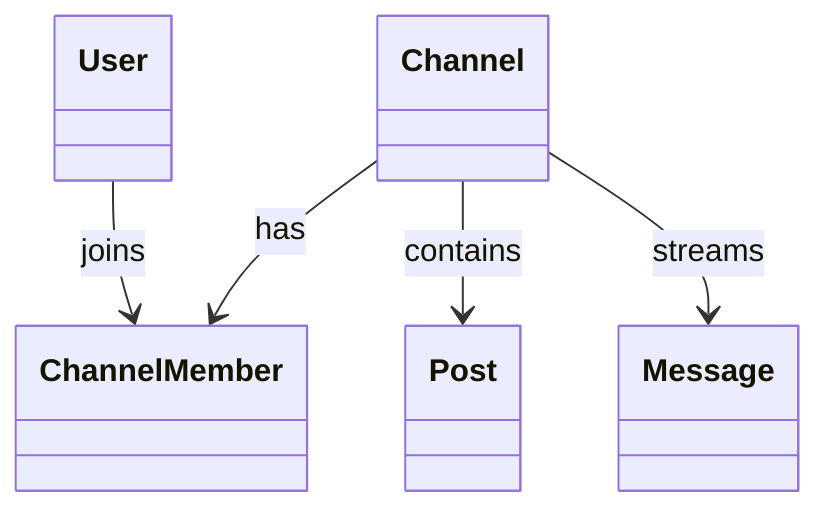

# 领域模型与词汇表

> 目的：统一业务语言。**代码中的类名、字段名、API 路径、文档术语必须与本文一致**。
> 当前为初始化内容，候选术语需在需求确认后逐一确认、补充定义，并标注状态（确认 / 候选 / 废弃）。

## 1. 使用规则

- 新增术语：先在此登记，确认后再进入代码与 API。
- 同义词只保留一个**规范术语**，其余标注为"同义词（禁用）"。
- 术语改名属于跨模块变更，必须走 ADR 或需求变更流程，并全仓库同步。
- 英文标识符与中文术语一一对应，禁止一词多译。

## 2. 候选术语（待需求确认）

> 下表为根据"社交频道平台"定位预置的候选术语，**语义以需求确认为准**，确认后去掉"候选"标记。

| 规范术语 | 英文标识 | 定义 | 同义词（禁用） | 状态 |
| --- | --- | --- | --- | --- |
| 频道 | `channel` | 内容发布与交流的容器，是平台的核心组织单元 | 群组、房间、版块 | 候选 |
| 频道成员 | `channel_member` | 加入某频道的用户及其角色 | 群成员 | 候选 |
| 成员角色 | `member_role` | 成员在频道内的权限身份（如所有者/管理员/成员） | 等级 | 候选 |
| 帖子 / 动态 | `post` | 发布在频道内的公开内容单元 | 文章、广播 | 候选 |
| 消息 | `message` | 实时会话中的单条交流内容 | 聊天、信息 | 候选 |
| 订阅 / 关注 | `subscription` | 用户对频道或用户的持续关注关系 | 收藏、追踪 | 候选 |
| 通知 | `notification` | 平台向用户推送的事件提醒 | 提醒、消息（冲突，禁用） | 候选 |
| 举报 | `report` | 用户对违规内容的申诉记录 | 投诉、举报单 | 候选 |
| 屏蔽 | `block` | 用户之间的单向/双向隔离关系 | 拉黑 | 候选 |
| 静音 | `mute` | 关闭某频道/对象通知但保留成员关系 | 免打扰 | 候选 |
| 审核 | `moderation` | 对内容进行检测、人工复核与处置的流程 | 审查 | 候选 |
| 会话 | `conversation` | 私聊或频道内消息的上下文容器 | 聊天窗口 | 候选 |

## 3. 领域模型（待需求确认后绘制）

> 待定：核心聚合、实体、值对象、聚合边界与不变量。
> 每个聚合需要回答：谁是聚合根、哪些操作是原子的、跨聚合如何协作（领域事件/最终一致）。

## 4. 术语变更记录

| 日期 | 变更 | 原因 |
| --- | --- | --- |
| 2026-11-14 | 初始化候选术语 | 需求未确认 |
