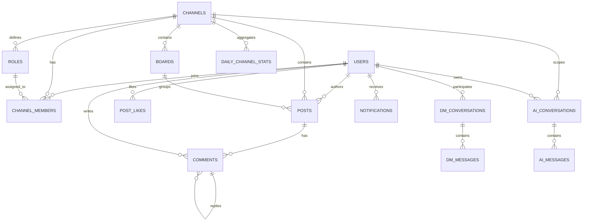

# 领域模型与词汇表

> 目的：统一业务语言。**代码中的类名、字段名、API 路径、文档术语必须与本文一致**。
> 术语状态：**确认**（需求已明确）/ **待确认**（需求待定）/ **禁用**（不再使用，仅记录历史）。

## 1. 使用规则

- 新增术语：先在此登记，确认后再进入代码与 API。
- 同义词只保留一个**规范术语**，其余标注为"同义词（禁用）"。
- 术语改名属于跨模块变更，必须走需求变更流程并全仓库同步。
- 英文标识符与中文术语一一对应，禁止一词多译。

## 2. 术语表

### 2.1 平台与账号

| 规范术语 | 英文标识 | 定义 | 同义词（禁用） | 状态 |
| --- | --- | --- | --- | --- |
| 平台 | `platform` | 本社交频道平台整体 | 系统、站点 | 确认 |
| 用户 | `user` | 注册用户账号 | 账号、会员 | 确认 |
| 游客 | `guest` | 未登录访问者（可浏览范围待确认） | 匿名用户 | 待确认 |
| 用户卡片 | `user_card` | 点击头像/用户名弹出的资料浮层 | 资料卡、名片 | 确认 |
| 签名 | `signature` | 用户个人简介文字 | 简介、bio | 确认 |
| 加好友 | `friend_request` | 用户间建立好友关系的行为 | 关注（暂不采用） | 待确认 |
| 私信 | `direct_message` / `dm` | 用户之间的一对一聊天 | 私聊、站内信 | 确认 |
| 会话 | `dm_conversation` | 两个用户之间的私信上下文 | 聊天窗口 | 确认 |

### 2.2 频道与组织

| 规范术语 | 英文标识 | 定义 | 同义词（禁用） | 状态 |
| --- | --- | --- | --- | --- |
| 频道 | `channel` | 内容发布与交流的容器，是平台核心组织单元 | 群组、房间、版块、社区 | 确认 |
| 频道号 | `channel_no` | 频道唯一数字编号，用于展示与搜索 | 频道 ID（对外展示时用） | 确认 |
| 频道类型 | `channel_type` | 公开 / 需审批 / 私密等可见性与加入方式 | — | 待确认 |
| 板块 | `board` | 频道内的内容分区（子版块） | 分区、版块、分类 | 确认 |
| 频道成员 | `channel_member` | 加入频道的用户及其身份组 | 群成员 | 确认 |
| 身份组 | `role` | 频道内权限集合，可自定义 | 角色、权限组 | 确认 |
| 频道主 | `owner` | 频道创建者，唯一，拥有全部权限 | 群主、创建者 | 确认 |
| 超级管理员 | `super_admin` | 频道主之外的最高管理身份组 | 管理员 | 确认 |
| 子板块管理员 | `board_moderator` | 仅管理指定板块的身份组 | 版主 | 确认 |
| 普通成员 | `member` | 默认身份组 | 成员、普通用户 | 确认 |
| 频道设置 | `channel_settings` | 头像/名称/成员/退出等的设置面板 | 频道信息 | 确认 |
| 全员禁言 | `mute_all` | 频道级禁言，仅主/超管可发言 | 全体禁言 | 确认 |
| 邀请 | `invite` | 邀请用户加入频道（方式待确认） | 拉人 | 待确认 |
| 解散频道 | `dissolve_channel` | 频道主销毁频道 | 删除频道 | 确认 |

### 2.3 内容与互动

| 规范术语 | 英文标识 | 定义 | 同义词（禁用） | 状态 |
| --- | --- | --- | --- | --- |
| 帖子 | `post` | 频道内发布的内容单元（短帖/长文） | 动态、文章、广播 | 确认 |
| 长文 | `long_post` | 富文本帖子：标题、正文、封面、视频、板块 | 文章 | 确认 |
| 帖子详情 | `post_detail` | 帖子完整内容页面 | 帖子页 | 确认 |
| 评论 | `comment` | 对帖子的评论 | 留言、回复（回复是评论的子类型） | 确认 |
| 回复 | `reply` | 对评论的回复（楼中楼） | 二级评论 | 确认 |
| 点赞 | `like` | 对帖子/评论的赞同操作 | 赞、喜欢 | 确认 |
| 浏览 | `view` | 帖子被查看的计数 | 阅读、曝光 | 确认 |
| 分享 | `share` | 分享帖子给好友或复制链接 | 转发 | 确认 |
| 置顶 | `pin` | 频道内置顶帖子 | 固定 | 确认 |
| 精华 | `essence` | 频道管理员标记的优质帖子 | 加精 | 确认 |
| 板块标签 | `post_board` | 帖子所属板块 | 分类 | 确认 |
| 举报 | `report` | 用户对违规内容的申诉 | 投诉 | 确认 |
| 作者名牌 | `author_badge` | 评论者为帖子作者时的标识 | — | 确认 |

### 2.4 发现与 AI

| 规范术语 | 英文标识 | 定义 | 同义词（禁用） | 状态 |
| --- | --- | --- | --- | --- |
| 频道动态 | `feed` | 已加入频道的帖子流（最新/热门） | 首页动态、时间线 | 确认 |
| 热门讨论 | `hot` | 全站热门内容聚合页 | 热门、发现 | 确认 |
| 我的频道 | `my_channels` | 当前用户已加入的频道列表 | 我的圈子 | 确认 |
| 当前频道 | `current_channel` | 正在浏览但未加入的频道（侧边栏临时项） | 浏览频道 | 确认 |
| 搜索历史 | `search_history` | 用户历史搜索关键词 | 最近搜索 | 确认 |
| 搜索联想 | `search_suggestion` | 输入时的候选词（已加入频道 + 全站热词） | 自动补全 | 确认 |
| 热词 | `hot_keyword` | 全站高频搜索词（按前缀聚合） | 热门搜索 | 确认 |
| 频道问问 | `ai_qa` | 基于全站公开帖子的 AI 问答功能 | AI 问答、智能问答 | 确认 |
| 频道助手 | `channel_assistant` | 频道内的 AI 账号（问答 + 自动运营） | AI 机器人、频道 AI | 确认 |
| AI 助手账号 | `assistant_account` | 频道助手对应的虚拟用户 | 机器人账号 | 确认 |
| AI 会话 | `ai_conversation` | 一次 AI 问答的对话上下文 | 对话、chat | 确认 |
| 深度思考 | `deep_thinking` | AI 问答的增强推理模式 | 深度模式 | 待确认 |
| 模型配置 | `ai_model_config` | AI 提供方与模型参数配置（LMStudio/OpenAI 兼容） | 模型设置 | 确认 |

### 2.5 运营与管理

| 规范术语 | 英文标识 | 定义 | 同义词（禁用） | 状态 |
| --- | --- | --- | --- | --- |
| 通知 | `notification` | 平台向用户推送的事件提醒 | 提醒、消息（禁用，与私信冲突） | 确认 |
| 互动消息 | `interaction_message` | 帖子被回复/点赞等互动产生的通知 | 动态消息 | 确认 |
| 系统消息 | `system_message` | 平台/频道管理的系统通知（删除、处罚等） | 系统通知 | 确认 |
| 频道管理中心 | `channel_management_center` | 频道主/管理员运营频道的后台 | 管理中心、后台 | 确认 |
| 管理日志 | `audit_log` | 频道内操作审计记录（谁做了什么） | 操作日志、审计日志 | 确认 |
| 数据中心 | `data_center` | 频道数据统计看板 | 数据统计、分析 | 确认 |
| 平台管理后台 | `platform_admin` | 平台级管理端（AI 配置、内容治理等） | 管理后台、后台 | 待确认 |
| 内容管理 | `content_management` | 管理中心内批量管理帖子的模块 | 帖子管理 | 确认 |

## 3. 领域模型（草案）

### 3.1 聚合与不变量（草案）

| 聚合 | 聚合根 | 关键不变量 |
| --- | --- | --- |
| 用户 | `User` | 用户名唯一；密码哈希存储；状态有效 |
| 频道 | `Channel` | 频道号唯一；频道主唯一；成员关系唯一（channel + user）；身份组属于频道 |
| 帖子 | `Post` | 必须属于一个频道与一个板块；作者为频道成员；置顶/精华仅管理员可改 |
| 评论 | `Comment` | 必须属于帖子；回复必须与父评论同帖；作者为频道成员或游客（待确认） |
| 私信 | `DmConversation` | 两个参与者唯一；消息有序；仅参与者可读写 |
| AI 会话 | `AiConversation` | 会话属于用户；频道助手会话绑定频道；消息可追溯模型 |
| 统计 | `DailyChannelStats` | 频道 + 日期唯一；只由聚合任务写入 |

## 4. 术语变更记录

| 日期 | 变更 | 原因 |
| --- | --- | --- |
| 2026-11-14 | 初始化候选术语 | 需求未确认 |
| 2026-11-14 | 按口述需求确认核心术语，新增频道/板块/身份组/AI/私信/管理类术语 | 需求分析完成 |
