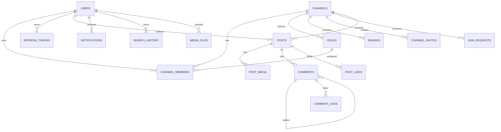

# 数据库设计

> 状态：**M1 设计稿**。表结构变更必须同步更新本文 + 新增 Flyway 迁移（只追加，不改历史）。
> 数据库：MySQL 8.0，字符集 `utf8mb4`，排序规则 `utf8mb4_0900_ai_ci`，引擎 InnoDB。

## 1. 设计约定

| 项 | 约定 |
| --- | --- |
| 主键 | `id CHAR(26)`（ULID，应用层生成，可排序、不可猜测） |
| 时间 | `DATETIME(3)`，UTC 存储，应用层转换；默认 `CURRENT_TIMESTAMP(3)` |
| 软删除 | `deleted_at DATETIME(3) NULL`；查询默认过滤 |
| 审计字段 | 业务表统一 `created_at`、`updated_at` |
| 计数 | `*_count BIGINT NOT NULL DEFAULT 0`，异步/事务内更新 |
| 外键 | 显式命名 `fk_<table>_<target>`；默认 `RESTRICT` |
| 唯一约束 | 显式命名 `uk_<table>_<columns>` |
| 索引 | 显式命名 `idx_<table>_<columns>` |
| 枚举 | 字符串存储（`VARCHAR(16/32)`），值在代码枚举中定义 |
| 大字段 | 帖子正文 `MEDIUMTEXT`；评论 `TEXT`；媒体单独表 / JSON 列 |

## 2. ER 关系（M1）

## 3. 表结构（M1）

### 3.1 `users`

| 列 | 类型 | 说明 |
| --- | --- | --- |
| `id` | CHAR(26) PK | ULID |
| `username` | VARCHAR(32) | 登录名，唯一 `uk_users_username` |
| `password_hash` | VARCHAR(100) | BCrypt |
| `nickname` | VARCHAR(32) | 展示名 |
| `avatar_url` | VARCHAR(500) NULL | 头像 |
| `signature` | VARCHAR(200) NULL | 签名 |
| `gender` | VARCHAR(16) NULL | `MALE` / `FEMALE` / `UNKNOWN` |
| `region` | VARCHAR(64) NULL | 地区 |
| `status` | VARCHAR(16) | `ACTIVE` / `BANNED` / `DISABLED` |
| `created_at` / `updated_at` / `deleted_at` | DATETIME(3) | 审计/软删 |

索引：`idx_users_status`。

### 3.2 `refresh_tokens`

| 列 | 类型 | 说明 |
| --- | --- | --- |
| `id` | CHAR(26) PK | — |
| `user_id` | CHAR(26) | `fk_refresh_tokens_user` |
| `token_hash` | CHAR(64) | SHA-256，唯一 `uk_refresh_tokens_hash` |
| `expires_at` | DATETIME(3) | 过期时间 |
| `revoked_at` | DATETIME(3) NULL | 撤销时间 |
| `user_agent` / `ip` | VARCHAR(255) / VARCHAR(45) | 可选审计 |
| `created_at` | DATETIME(3) | — |

索引：`idx_refresh_tokens_user`。

### 3.3 `channels`

| 列 | 类型 | 说明 |
| --- | --- | --- |
| `id` | CHAR(26) PK | ULID |
| `channel_no` | BIGINT | 频道号，唯一 `uk_channels_no`（创建时生成） |
| `name` | VARCHAR(64) | 频道名 |
| `avatar_url` | VARCHAR(500) | 头像 |
| `cover_url` | VARCHAR(500) NULL | 封面/背景 |
| `description` | VARCHAR(1000) NULL | 简介 |
| `type` | VARCHAR(16) | `PUBLIC` / `PRIVATE` |
| `visibility` | VARCHAR(16) | `PUBLIC_VISIBLE` / `MEMBERS_ONLY` |
| `owner_id` | CHAR(26) | 频道主，`fk_channels_owner` |
| `member_count` / `post_count` | BIGINT | 冗余计数 |
| `status` | VARCHAR(16) | `ACTIVE` / `DISSOLVED` / `BANNED` |
| `created_at` / `updated_at` / `deleted_at` | DATETIME(3) | — |

索引：`idx_channels_owner`、`idx_channels_type_status`。

### 3.4 `roles`（身份组）

| 列 | 类型 | 说明 |
| --- | --- | --- |
| `id` | CHAR(26) PK | — |
| `channel_id` | CHAR(26) | `fk_roles_channel` |
| `name` | VARCHAR(32) | 唯一 `uk_roles_channel_name` |
| `description` | VARCHAR(200) NULL | — |
| `permissions` | JSON | 权限点数组，如 `["post.create","comment.create"]` |
| `scope_board_id` | CHAR(26) NULL | 子板块管理员范围 |
| `is_system` | TINYINT(1) | 系统内置（频道主等） |
| `sort` | INT | 排序 |
| `created_at` / `updated_at` | DATETIME(3) | — |

### 3.5 `channel_members`

| 列 | 类型 | 说明 |
| --- | --- | --- |
| `id` | CHAR(26) PK | — |
| `channel_id` | CHAR(26) | — |
| `user_id` | CHAR(26) | — |
| `role_id` | CHAR(26) | 身份组 |
| `status` | VARCHAR(16) | `ACTIVE` / `MUTED` / `LEFT` / `KICKED` |
| `muted_until` | DATETIME(3) NULL | 个人禁言到期 |
| `joined_at` | DATETIME(3) | — |
| `created_at` / `updated_at` | DATETIME(3) | — |

唯一：`uk_channel_members_channel_user`（`channel_id`,`user_id`）；索引：`idx_channel_members_user`。

### 3.6 `boards`（板块）

| 列 | 类型 | 说明 |
| --- | --- | --- |
| `id` | CHAR(26) PK | — |
| `channel_id` | CHAR(26) | — |
| `name` | VARCHAR(32) | 唯一 `uk_boards_channel_name` |
| `description` | VARCHAR(200) NULL | — |
| `sort` | INT | 排序 |
| `post_count` | BIGINT | 冗余计数 |
| `created_at` / `updated_at` | DATETIME(3) | — |

### 3.7 `channel_invites` / `join_requests`

| 表 | 关键列 |
| --- | --- |
| `channel_invites` | `id`、`channel_id`、`token_hash CHAR(64)`（唯一）、`requires_approval`、`expires_at`、`max_uses`、`used_count`、`created_by`、`revoked_at`、`created_at` |
| `join_requests` | `id`、`channel_id`、`user_id`、`invite_id`、`status`（`PENDING`/`APPROVED`/`REJECTED`）、`reviewed_by`、`reviewed_at`、`created_at`；索引 `idx_join_requests_channel_status` |

### 3.8 `posts`

| 列 | 类型 | 说明 |
| --- | --- | --- |
| `id` | CHAR(26) PK | ULID（本身可排序） |
| `channel_id` / `board_id` / `author_id` | CHAR(26) | — |
| `title` | VARCHAR(200) NULL | 长文标题 |
| `content` | MEDIUMTEXT | 正文（HTML 或纯文本，见 `content_format`） |
| `content_format` | VARCHAR(16) | `PLAIN` / `HTML`（长文富文本） |
| `cover_url` | VARCHAR(500) NULL | 封面 |
| `view_count` / `like_count` / `comment_count` / `share_count` | BIGINT | 计数 |
| `is_pinned` / `is_essence` | TINYINT(1) | 置顶/精华 |
| `pinned_at` | DATETIME(3) NULL | — |
| `status` | VARCHAR(16) | `PUBLISHED` / `DELETED` / `HIDDEN` |
| `created_at` / `updated_at` / `deleted_at` | DATETIME(3) | — |

索引：`idx_posts_channel_created`（`channel_id`,`status`,`created_at`）、`idx_posts_channel_board_created`、`idx_posts_author`、`idx_posts_pinned`。

### 3.9 `post_media`

`id`、`post_id`、`media_type`（`IMAGE`/`VIDEO`）、`url`、`thumb_url`、`width`、`height`、`duration_ms`、`sort`、`created_at`；索引 `idx_post_media_post`。

### 3.10 `comments`

| 列 | 类型 | 说明 |
| --- | --- | --- |
| `id` | CHAR(26) PK | — |
| `post_id` / `author_id` | CHAR(26) | — |
| `parent_id` | CHAR(26) NULL | 顶级评论为空；回复指向顶级评论 |
| `reply_to_user_id` | CHAR(26) NULL | 回复对象 |
| `content` | TEXT | 文本 |
| `media` | JSON NULL | 评论媒体 `[{type,url,thumbUrl}]` |
| `emoji` | JSON NULL | 表情列表（可选） |
| `like_count` | BIGINT | — |
| `status` | VARCHAR(16) | `PUBLISHED` / `DELETED` / `HIDDEN` |
| `created_at` / `deleted_at` | DATETIME(3) | — |

索引：`idx_comments_post_created`、`idx_comments_post_likes`、`idx_comments_parent`。

### 3.11 点赞与通知

| 表 | 关键列 |
| --- | --- |
| `post_likes` | `id`、`post_id`、`user_id`、`created_at`；唯一 `uk_post_likes_post_user` |
| `comment_likes` | `id`、`comment_id`、`user_id`、`created_at`；唯一 `uk_comment_likes_comment_user` |
| `notifications` | `id`、`user_id`、`type`（`POST_LIKED`/`POST_COMMENTED`/`COMMENT_REPLIED`/`SYSTEM`）、`channel_id`、`post_id`、`comment_id`、`actor_id`、`title`、`content`、`is_read`、`created_at`；索引 `idx_notifications_user_read_created` |

### 3.12 搜索与媒体

| 表 | 关键列 |
| --- | --- |
| `search_history` | `id`、`user_id`、`keyword VARCHAR(100)`、`created_at`；唯一 `uk_search_history_user_keyword`；索引 `idx_search_history_user_created` |
| `search_logs` | `id`、`user_id` NULL、`keyword`、`scope`（`GLOBAL`/`CHANNEL`）、`channel_id` NULL、`result_count`、`created_at`；索引 `idx_search_logs_keyword`（前缀索引）、`idx_search_logs_created` |
| `media_files` | `id`、`uploader_id`、`media_type`、`storage_path`、`url`、`thumb_url`、`size_bytes`、`width`、`height`、`duration_ms`、`status`、`created_at` |

## 4. 后续阶段预留（M2/M3）

| 表 | 阶段 | 说明 |
| --- | --- | --- |
| `friend_relations`、`dm_conversations`、`dm_messages` | M2 | 好友与私信 |
| `channel_audit_logs` | M2 | 管理日志 |
| `daily_channel_stats` | M2 | 数据中心聚合 |
| `reports` | M2 | 举报 |
| `ai_model_configs`、`ai_conversations`、`ai_messages`、`channel_ai_settings`、`ai_task_logs` | M3 | AI |
| `channel_recommendations` | M3 | 频道推荐结果 |

## 5. 迁移与测试

- 迁移文件：`backend/src/main/resources/db/migration/V1__init.sql`（M1 全量表）。
- 规则：只追加、不回改；破坏性变更两阶段；大表变更评估锁时间（规范 §8）。
- 本地库：`my_social_channel`；测试库：`my_social_channel_test`。
- 集成测试使用 `@Transactional` 回滚；CI 使用 MySQL 8 服务容器。
- 备份：生产每日备份；恢复演练每月一次。

## 6. 待补充

- 索引在执行计划下验证（M1 开发后）
- 计数一致性策略（事务内更新 vs 定时校正）
- 浏览去重策略（M2）
- 数据保留与归档策略（管理日志、搜索日志）
