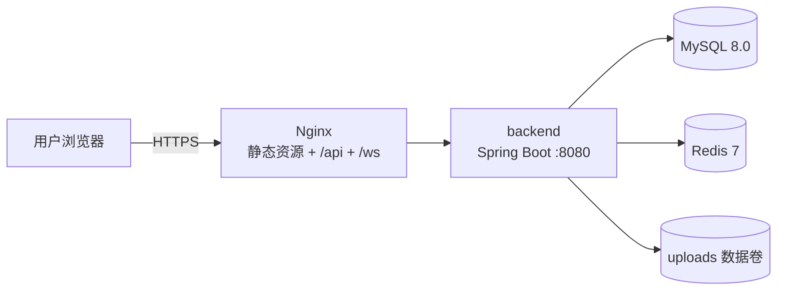

# 部署与运维

> 目标：单机 Docker Compose 一键部署，运维可照做；所有命令可直接复制执行。
> 当前状态：配置文件已交付（`deploy/`），**本机无 Docker 未验证**；需在服务器/具备 Docker 的环境验证后更新状态。

## 1. 环境

| 环境 | 用途 | 访问方式 |
| --- | --- | --- |
| local | 本机开发 | 前端 `pnpm dev`（5173）→ Vite 代理到后端 8080；MySQL 3306；Redis 可选 |
| prod | 生产 | Nginx（80/443）→ backend:8080 → mysql:3306 / redis:6379（容器网络内部） |

## 2. 部署拓扑



- 前端构建为静态文件，由 Nginx 托管；`/api`、`/uploads`、`/ws` 反向代理到 backend。
- 上传文件默认存容器内 `/app/uploads`，挂载数据卷 `uploads`；后续可切对象存储（MediaService 适配）。
- Nginx 屏蔽 `/actuator/` 外网访问。

## 3. 配置项

| 配置 | 环境变量 | 说明 |
| --- | --- | --- |
| 数据库 | `DB_URL`、`DB_USERNAME`、`DB_PASSWORD` | JDBC URL（UTC、utf8mb4） |
| JWT | `JWT_SECRET` | ≥32 字节随机值；每个环境不同 |
| Redis | `REDIS_HOST`、`REDIS_PORT`、`REDIS_PASSWORD` | 多实例共享限流（`RATE_LIMIT_STORE=redis`）；单机可不用 |
| 限流 | `RATE_LIMIT_ENABLED`、`RATE_LIMIT_STORE`、`RATE_LIMIT_TRUST_FORWARDED_FOR` | 默认开启 + 内存计数；Nginx 之后设 `trust-forwarded-for=true` |
| AI | `AI_API_KEY_SECRET`、`AI_SCHEDULER_ENABLED` | API Key 加密密钥（生产必填）；频道助手调度开关 |
| Cookie | `COOKIE_SECURE` | 生产必须 `true`（HTTPS） |
| CORS | `CORS_ALLOWED_ORIGINS` | 生产填实际域名，禁止 `*` |
| 上传 | `UPLOAD_DIR` | 默认 `/app/uploads`（容器） |
| 端口 | `HTTP_PORT` | Nginx 对外端口（默认 80） |

完整模板见 [`deploy/.env.example`](../deploy/.env.example)。

## 4. 首次部署

```bash
cd deploy
cp .env.example .env   # 修改密码/密钥/域名
docker compose up -d --build
docker compose ps      # 等待 mysql/redis/backend healthy
docker compose logs -f backend
```

- MySQL 首次启动会创建库与账号；后端启动时 Flyway 自动执行 `V1`…`V4` 迁移并创建表。
- 验证：注册/登录/发帖/评论主流程；上传图片；AI 配置页（如 LMStudio 可达）。

## 5. 发布流程

1. 本地：测试 + 构建通过，更新 `CHANGELOG.md` 与版本号。
2. 服务器：`git pull` → `docker compose build` → `docker compose up -d`（滚动重建 backend/nginx）。
3. 执行 [发布检查清单](templates/发布检查清单.md)：迁移可回滚、健康检查、冒烟、监控。
4. 发布后观察 30 分钟：错误率、延迟、登录/发帖量。
5. 发布记录归档到 `docs/archive/releases/`。

## 6. 回滚

- 代码回滚：`git checkout <上一个发布 tag>` → `docker compose up -d --build`（镜像重新构建）。
- 数据回滚：Flyway 迁移只追加，**代码回滚不自动回滚数据库**；破坏性迁移按两阶段发布（先加列后删列），确保旧代码可运行。
- 紧急处置：数据库/Redis 保留数据卷，`docker compose down` 后按旧版本镜像重建。

## 7. 备份与恢复

```bash
# 数据库
docker compose exec -T mysql mysqldump -u root -p"$MYSQL_ROOT_PASSWORD" --single-transaction isles > backup.sql
# 上传文件
docker run --rm -v isles_uploads:/data -v "$PWD":/backup alpine tar czf /backup/uploads.tar.gz -C /data .
# 恢复
docker compose exec -T mysql mysql -u root -p"$MYSQL_ROOT_PASSWORD" isles < backup.sql
docker run --rm -v isles_uploads:/data -v "$PWD":/backup alpine sh -c "rm -rf /data/* && tar xzf /backup/uploads.tar.gz -C /data"
```

- 数据库每日备份，保留 ≥ 7 天；每月做一次恢复演练（有备份 ≠ 能恢复）。

## 8. 日志与监控

- 应用日志：`docker compose logs -f backend`（生产建议配置 Logback JSON 输出并接入采集）。
- 访问日志：Nginx 默认 `access.log`（容器内 `/var/log/nginx`）。
- 健康检查：backend `/actuator/health`（容器内部探针使用），Nginx 对外屏蔽。
- 关键指标（错误率/延迟/业务量）后续接入 Prometheus/Grafana（M3+ 可选）。

## 9. 已知限制

- 本机未安装 Docker，Compose 未实际运行验证；需在服务器验证并补充发布记录。
- 尚未配置 HTTPS 证书（需前置 TLS 终端或扩展 nginx.conf）。
- 上传目录为本地磁盘，未实现多实例共享存储/对象存储。
- 多实例部署：限流可切 Redis 共享配额；STOMP 广播需 Redis Pub/Sub 与负载均衡（架构已预留，尚未实现）。
- 数据备份为手工/脚本方式，未接入自动备份任务。

## 10. 待办

- [ ] 在服务器验证 Compose 全链路（构建/迁移/健康检查/上传/WebSocket）
- [ ] HTTPS/TLS 配置与 HSTS
- [ ] 自动备份与恢复演练记录
- [ ] 监控告警（错误率/延迟/磁盘）
- [ ] 发布记录归档流程演练
