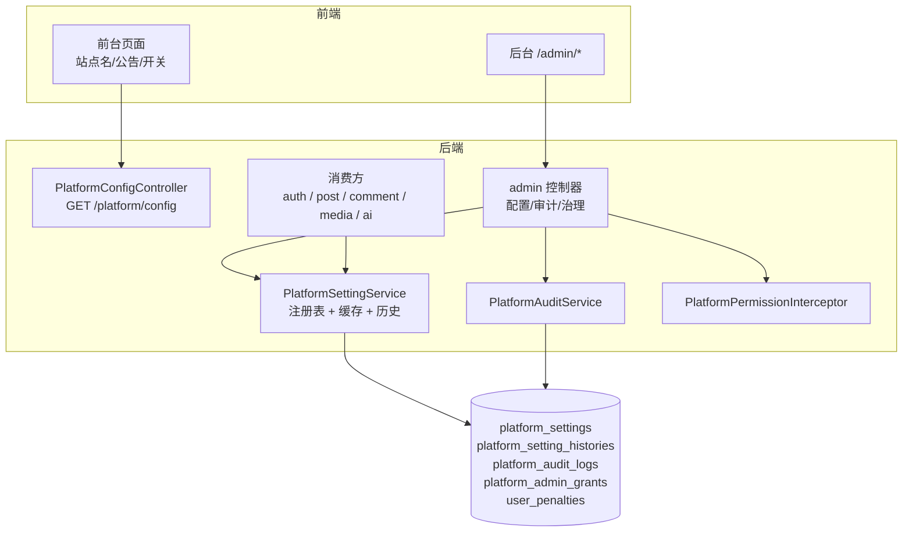
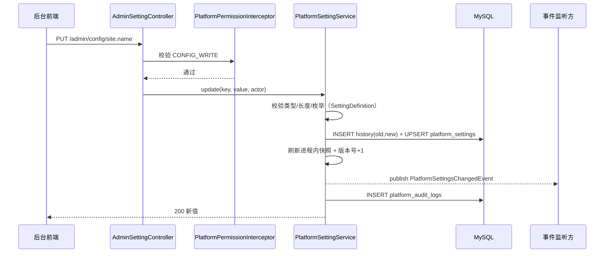
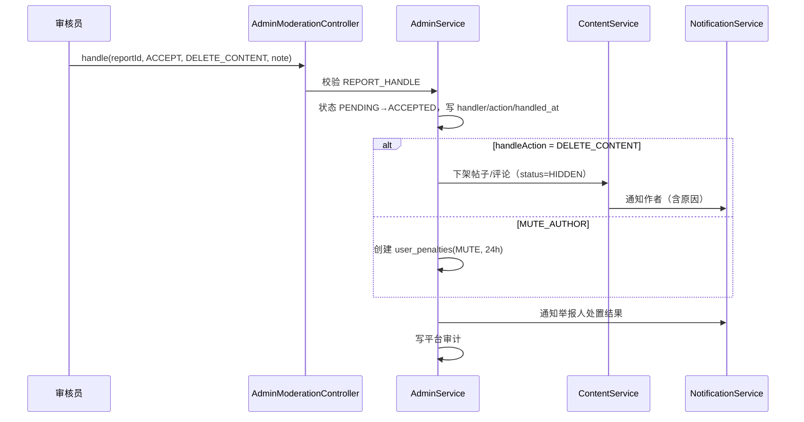

# 平台管理后台设计

> 目标：把「平台配置」从 `application.yml` / 环境变量 / 手工改库，升级为**可在后台运行时修改、有权限约束、有审计留痕**的能力。
> 本文只覆盖平台侧（`/admin/*` 与平台公共配置），频道管理中心（`/channels/{id}/manage/*`）不在范围内。

## 0. 实施状态（2026-11-16）

| 阶段 | 后端 | 前端 |
| --- | --- | --- |
| P0 配置中心 | ✅ 已交付：`platform_settings` / 历史 / 公开配置 / 后台读写 / 注册开关接入 | 本轮交付中（`AdminSettingsView`） |
| P1 权限与审计 | ✅ 已交付：4 角色 + 15 权限点（读写分离）、注解拦截器、管理员授权、只追加审计 | 本轮交付中（管理员页、审计页） |
| P2 治理闭环 | ✅ 已交付：举报状态修复、内容下架/恢复、用户处罚（封禁/禁言/警告）、登录与发言拦截 | 本轮交付中（内容治理、处罚抽屉、举报页状态值） |
| P3 运营与数据 | ✅ 已交付：公告、敏感词库与命中记录、趋势曲线、热词维护（V7） | 本轮交付中（公告页、词库页、概览折线图） |
| P4 助手模型与工具调用 | ✅ 已交付：频道助手可选模型（V8）、AI 工具调用（search_channel_posts / search_global_posts / get_post_detail）、来源引用由实际命中生成 | 待接：频道设置页模型下拉、SSE `sources` 事件、模型表单「支持工具调用」开关 |

实现与本文的差异（以代码为准）：

- V6 交付 P0–P2 的 5 张表，V7 交付 P3 的 `announcements` / `sensitive_words` / `sensitive_word_hits`。
- 敏感词处理方式由 `content.sensitiveWord.mode` 决定（默认 `REVIEW`）：`MASK` 命中词替换为 `***` 后入库，
  `BLOCK` 直接 422 拒绝；命中记录保存本次实际处理方式。`REVIEW` 仍是默认，误杀成本高于漏放。
- `placement=INBOX` 的公告发布时，向全站活跃用户分批写系统通知（每批 500 行一条 INSERT，按 id 游标分页）；
  `BANNER`/`MODAL` 由前台公告组件渲染，不重复写站内信。通知失败不回滚发布。
- 浏览量按「有效浏览」计：作者本人不计，同一会话 30 分钟内重复访问只计一次（进程内去重，多实例各算各的）。
- 首批配置项 22 个（7 个分组），见 `com.isles.platform.setting.SettingDefinitions`；`secret` 类配置
  （AI API Key 等）继续走 `ai_model_configs` 加密存储与 L1 环境变量，未纳入配置中心。
- 平台审计与配置历史均只追加；审计查询无删除/修改入口。
- 全站禁言通过 `PlatformMuteInterceptor` 只拦截「发帖 / 编辑帖子 / 评论」三类写接口，点赞、分享不受影响。
- 工具调用默认关闭（`ai_model_configs.tool_call_enabled=0`）：未开启或模型不支持时自动降级为关键词检索，
  对话功能不受影响；降级原因写日志（`AiChatService`/`AiTaskService`），不改变接口契约。
- 频道助手模型为空/已禁用时回落平台默认（`ON DELETE SET NULL` + 运行期兜底），不会让自动任务失败。

### 0.1 P4 交付要点（V8）

| 能力 | 实现 | 关键约束 |
| --- | --- | --- |
| 频道助手可选模型 | `channel_ai_settings.model_config_id`（可空）+ `GET /channels/{id}/ai/models` | 只返回启用模型；字段裁剪为 `id/name/model/visionEnabled/reasoningEnabled/isDefault`，不含 Base URL 与密钥 |
| 模型解析 | `AiTaskService#resolveChannelModel` | 频道指定且启用 → 用之；缺失/禁用 → 回落平台默认并 `WARN` |
| 工具定义 | `com.isles.ai.tool.AiToolRegistry` | 3 个只读工具；频道会话才有 `search_channel_posts`；参数非法/不可见返回结构化错误给模型 |
| 工具循环 | `AiToolLoopService` | 最多 2 轮；每轮按剩余时间下发超时；用户停止立即中断；第 3 轮不带 tools |
| 流式解析 | `OpenAiCompatibleProvider` | 按 `index` 累积 `id`/`name`/`arguments` 分片，拼完才回调 |
| 来源引用 | `AiChatService` + SSE `sources` 事件 | 由实际命中帖子生成并落库；未命中时回落关键词结果；**事件无条件下发**（0 命中为空数组），前端以此为唯一信号 |
| 任务日志可追溯 | V9：`ai_task_logs.model_config_id` / `model` | 频道指定与回落默认都记录；配置删除后 `model` 快照仍可读 |

## 1. 背景与目标

### 1.1 现状盘点（基于代码实测）

平台后台**已有骨架**，但只覆盖「看数据 + 封禁 + AI 模型」三件事：

| 能力 | 现状 | 代码位置 |
| --- | --- | --- |
| 管理员身份 | `users.platform_role=ADMIN` 或 `PLATFORM_ADMIN_USERNAMES` 白名单 | `admin/service/AdminAuthService.java` |
| 数据概览 | 用户/频道/帖子/评论总数、当日新增、AI 用量、待处理举报 | `AdminController#overview` |
| 用户治理 | 列表 + 封禁/解封（只改 `status`，无原因/期限/通知） | `AdminService#banUser` |
| 频道治理 | 列表 + 封禁/解封 | `AdminService#banChannel` |
| 举报处置 | 列表 + 通过/驳回 | `AdminService#handleReport` |
| AI 配置 | 完整 CRUD + 连通性测试 + Key 加密 + 思考模式 | `AdminAiConfigController` |
| 前端 | 5 个页面：概览 / AI 配置 / 举报 / 用户 / 频道 | `frontend/src/pages/admin/*` |

### 1.2 缺口：为什么说「没有后端来配置平台」

1. **没有平台配置存储**：站点名、公告、注册开关、上传上限、限流阈值、AI 配额等全部硬编码在 `application.yml`，改一个值要改文件 + 重启；代码中现有 **15 处 `@Value` 注入**，散落在 auth / media / ai / cors 各处。
2. **没有配置读取接口**：前端拿不到站点名、公告、注册是否开放，无法做「运营位」。
3. **没有管理员管理**：加管理员只能 `UPDATE users SET platform_role='ADMIN'` 或改环境变量重启，且只有 ADMIN 一个粒度——无法区分「审核员」和「运维」。
4. **没有平台审计**：只有频道级 `channel_audit_logs`；谁封了谁、谁改了配置，事后无法追溯（现有后台写操作只打 `log.info`）。
5. **治理不闭环**：不能下架/恢复帖子与评论；不能对用户禁言（只有全站封禁）；举报处置不写处理人/时间/动作。
6. **举报模型不匹配**：`reports.channel_id NOT NULL`，无法承载「举报用户/举报频道」的平台级举报；`target_type` 只有 POST/COMMENT。
7. **无运营配置**：公告、敏感词、热词/推荐位都没有后台维护入口（`hot_keywords` 只由搜索自动聚合）。
8. **无趋势数据**：概览只有当日快照，没有按日趋势。

### 1.3 现存缺陷（本次一并修复）

| # | 缺陷 | 证据 | 影响 |
| --- | --- | --- | --- |
| D1 | 平台举报状态值与表定义不一致 | `AdminService#handleReport` 写 `DISMISSED`/`RESOLVED`；表注释与频道侧 `Report.Status` 是 `PENDING/ACCEPTED/REJECTED` | 平台处置后，频道侧举报列表按状态筛选查不到；状态机分裂 |
| D2 | 处置不写处理人/动作/时间 | `AdminReportMapper#updateStatus` 只更新 `status` | `handler_id`/`handle_action`/`handled_at` 永远为空，无法追责 |
| D3 | 举报 Mapper 用 `SELECT *` + `Map` + 表存在性探测 | `AdminReportMapper#countReportsTable` | 字段改名即静默降级为 `available=false`，问题被掩盖 |
| D4 | 管理员校验靠每个方法手工 `requireAdmin()` | `AdminController` 11 处 | 新增接口漏写即越权，无编译期/统一拦截保障 |

### 1.4 目标与非目标

**目标**

- 平台配置可视化维护，**保存即生效**（无需重启），有历史与回滚。
- 平台人员分角色、可授权、可撤销；所有写操作留审计。
- 举报 → 处置 → 内容下架/用户处罚 → 通知，形成闭环。
- 对外提供**只读公共配置**，供前台展示站点信息与开关。

**非目标**

- 不做多租户 / 多站点。
- 不做「发帖先审后发」的完整审核工作流（只预留开关与队列字段，P3 评估）。
- 不接管频道内的身份组与权限体系（沿用现有 `roles.permissions`）。
- 不引入工作流引擎、规则引擎等重型组件。

## 2. 方案概述

### 2.1 三层配置模型

| 层 | 载体 | 内容 | 变更方式 |
| --- | --- | --- | --- |
| L1 启动级 | 环境变量 / `application.yml` | 数据源、JWT 密钥、端口、上传根目录、加密密钥、CORS | 改配置 + 重启，**不进后台** |
| L2 运行时配置 | 新表 `platform_settings` | 站点信息、注册准入、内容策略、互动参数、AI 全局参数、运营开关 | 后台表单，**热更新** |
| L3 业务配置 | 现有表 | AI 模型、频道助手设置、公告、敏感词、举报处置 | 各自后台页面 |

判定规则：**改了需要重启进程才能生效的（连接串、密钥、端口）留在 L1；纯业务语义的进 L2**。密钥类配置即使进 L2，也必须加密落库且只写不读。

### 2.2 配置注册表：代码是默认值的唯一事实来源

不在数据库里预置配置行，而是在代码中用 `SettingDefinitions` 声明每个键的**类型、默认值、校验、是否公开、是否加密**；数据库 `platform_settings` 只存**被覆盖的值**。

好处：

- 新增配置项只改代码，**不需要写迁移**；升级不会出现「库里少一行导致 NPE」。
- 「恢复默认」= 删除覆盖行，语义清晰。
- 类型与校验集中在注册表，前后端共用同一份元数据（后台表单按 `type` 自动渲染）。
- 避免 `V6` 之后每次加配置都要发 `V7/V8`。

### 2.3 架构与依赖方向



依赖方向：`platform` 包**不依赖** `admin` 包；`admin` 只做接口编排。消费方（auth/post/ai）依赖 `platform.setting`，因此配置中心必须独立成包，不能塞进 `admin`。

### 2.4 关键取舍

| 取舍 | 选择 | 理由 |
| --- | --- | --- |
| 配置存 JSON 一列 vs 一行一项 | **一行一项（key 主键）** | 便于按 key 审计、回滚、局部更新；量级只有几十行 |
| 自定义角色 vs 固定角色 | **固定 4 角色 + 权限点** | 单人维护，自定义角色是过度设计；权限点保留扩展性 |
| 处罚写 `users.status` vs 独立表 | **独立 `user_penalties`** | 需要期限、原因、撤销、历史；`status` 只表达「当前是否可用」 |
| 配置缓存 | **进程内快照 + 30s TTL 兜底 + 写穿透刷新** | 单实例部署；多实例用 Redis pub/sub 扩展（预留事件） |
| 敏感词是否阻断 | **默认 REVIEW（只记录）**，可切 MASK/BLOCK | 误杀成本高于漏放；配置项可在后台即时切换 |

## 3. 模块与职责

### 3.1 新增包结构

```
com.isles.platform
├── setting
│   ├── PlatformSetting.java            # 实体，key 为主键
│   ├── PlatformSettingHistory.java
│   ├── PlatformSettingMapper.java
│   ├── PlatformSettingHistoryMapper.java
│   ├── SettingType.java                # STRING/INT/BOOL/JSON/ENUM
│   ├── SettingDefinition.java          # record：key/group/label/type/default/public/secret/validator
│   ├── SettingDefinitions.java         # 注册表（SSOT）
│   ├── PlatformSettingService.java     # 读缓存、写事务、历史、事件
│   ├── PlatformSettingsChangedEvent.java
│   └── SettingItem.java                # 后台返回：元数据 + 当前值 + 是否覆盖
├── audit
│   ├── PlatformAuditLog.java
│   ├── PlatformAuditLogMapper.java
│   └── PlatformAuditService.java
├── permission
│   ├── PlatformRole.java               # SUPER_ADMIN/OPERATOR/MODERATOR/VIEWER
│   ├── PlatformPermission.java         # 权限点枚举
│   ├── PlatformPermissionMatrix.java   # 角色 → 权限集合
│   ├── RequirePlatformPermission.java  # 注解
│   ├── PlatformPermissionInterceptor.java
│   ├── PlatformAdminGrant.java
│   ├── PlatformAdminGrantMapper.java
│   └── PlatformAdminService.java       # 授权/撤销/查询/鉴权
├── penalty
│   ├── UserPenalty.java
│   ├── UserPenaltyMapper.java
│   └── PenaltyService.java
├── announcement
│   ├── Announcement.java / Mapper / AnnouncementService.java
└── wordfilter
    ├── SensitiveWord.java / Mapper
    └── SensitiveWordService.java       # 匹配 + 命中记录
```

接口层仍放 `com.isles.admin.controller`，按资源拆：

| 控制器 | 职责 |
| --- | --- |
| `AdminSettingController` | 配置读写、历史、重置 |
| `AdminAdminController` | 平台管理员授权/撤销 |
| `AdminAuditController` | 审计查询（只读） |
| `AdminModerationController` | 帖子/评论下架与恢复、举报处置 |
| `AdminPenaltyController` | 处罚创建/撤销/查询 |
| `AdminAnnouncementController` | 公告 CRUD |
| `AdminWordController` | 敏感词 CRUD/导入 |
| `AdminStatsController` | 趋势数据 |

### 3.2 与现有代码的改造点

| 现有文件 | 改造 |
| --- | --- |
| `admin/service/AdminService.java` | 举报处置改为 `ACCEPTED/REJECTED` + 写 `handler_id/handle_action/handled_at`；封禁用户改为创建 `user_penalties` 并写审计 |
| `admin/mapper/AdminReportMapper.java` | 删除表存在性探测与 `SELECT *`，改强类型实体 + 条件查询（支持 targetType/关键字/时间） |
| `admin/controller/AdminController.java` | 方法上的 `requireAdmin()` 替换为 `@RequirePlatformPermission`，保留类级兜底 |
| `admin/service/AdminAuthService.java` | 保留白名单作为**引导超管**，其余走 `platform_admin_grants` |
| `ai/service/ApiKeyCipher.java` | 上移为 `common/crypto/SecretCipher.java`，配置中心的 secret 项复用（保留旧类委托，避免大范围改动） |
| `auth/service/*`（注册） | 读取 `auth.register.enabled` 等运行时开关 |
| `post/service/*`、`comment/service/*` | 读取内容长度上限；接入敏感词（P3） |
| `media/service/*` | 业务层校验读取 `media.*.maxMb`（Spring multipart 硬上限仍留 L1） |

## 4. 数据模型变更

迁移文件：`backend/src/main/resources/db/migration/V6__platform_admin_console.sql`（只追加，符合 `docs/00 §9`）。

### 4.1 新增表

```sql
-- 运行时配置覆盖值：只存被覆盖的 key，默认值在 SettingDefinitions 中
CREATE TABLE platform_settings (
    setting_key   VARCHAR(100) NOT NULL COMMENT '配置键，如 site.name',
    setting_value TEXT         NULL     COMMENT '覆盖值（字符串形式，按 type 解析）',
    updated_by    CHAR(26)     NULL,
    updated_at    DATETIME(3)  NOT NULL DEFAULT CURRENT_TIMESTAMP(3) ON UPDATE CURRENT_TIMESTAMP(3),
    PRIMARY KEY (setting_key),
    CONSTRAINT fk_platform_settings_updated_by FOREIGN KEY (updated_by) REFERENCES users (id)
        ON DELETE SET NULL ON UPDATE RESTRICT
) ENGINE = InnoDB DEFAULT CHARSET = utf8mb4 COLLATE = utf8mb4_0900_ai_ci COMMENT = '平台运行时配置';

CREATE TABLE platform_setting_histories (
    id          CHAR(26)     NOT NULL COMMENT 'ULID',
    setting_key VARCHAR(100) NOT NULL,
    old_value   TEXT         NULL,
    new_value   TEXT         NULL,
    actor_id    CHAR(26)     NULL,
    ip          VARCHAR(45)  NULL,
    created_at  DATETIME(3)  NOT NULL DEFAULT CURRENT_TIMESTAMP(3),
    PRIMARY KEY (id),
    KEY idx_platform_setting_histories_key_created (setting_key, created_at),
    KEY idx_platform_setting_histories_actor (actor_id)
) ENGINE = InnoDB DEFAULT CHARSET = utf8mb4 COLLATE = utf8mb4_0900_ai_ci COMMENT = '平台配置变更历史';

CREATE TABLE platform_audit_logs (
    id          CHAR(26)     NOT NULL COMMENT 'ULID',
    actor_id    CHAR(26)     NULL,
    actor_name  VARCHAR(32)  NULL COMMENT '冗余快照，防改名/删号后无法追溯',
    action      VARCHAR(64)  NOT NULL COMMENT 'platform.config.update / platform.user.ban',
    target_type VARCHAR(32)  NULL COMMENT 'USER/CHANNEL/POST/COMMENT/REPORT/CONFIG/ADMIN',
    target_id   CHAR(26)     NULL,
    detail      JSON         NULL COMMENT 'before/after、原因等',
    ip          VARCHAR(45)  NULL,
    user_agent  VARCHAR(255) NULL,
    created_at  DATETIME(3)  NOT NULL DEFAULT CURRENT_TIMESTAMP(3),
    PRIMARY KEY (id),
    KEY idx_platform_audit_logs_created (created_at),
    KEY idx_platform_audit_logs_actor_created (actor_id, created_at),
    KEY idx_platform_audit_logs_action_created (action, created_at),
    KEY idx_platform_audit_logs_target (target_type, target_id)
) ENGINE = InnoDB DEFAULT CHARSET = utf8mb4 COLLATE = utf8mb4_0900_ai_ci COMMENT = '平台操作审计（只追加）';

CREATE TABLE platform_admin_grants (
    id         CHAR(26)    NOT NULL,
    user_id    CHAR(26)    NOT NULL,
    role       VARCHAR(24) NOT NULL COMMENT 'SUPER_ADMIN/OPERATOR/MODERATOR/VIEWER',
    granted_by CHAR(26)    NULL,
    granted_at DATETIME(3) NOT NULL DEFAULT CURRENT_TIMESTAMP(3),
    expires_at DATETIME(3) NULL,
    revoked_at DATETIME(3) NULL,
    PRIMARY KEY (id),
    UNIQUE KEY uk_platform_admin_grants_user (user_id),
    KEY idx_platform_admin_grants_role (role),
    CONSTRAINT fk_platform_admin_grants_user FOREIGN KEY (user_id) REFERENCES users (id)
        ON DELETE CASCADE ON UPDATE RESTRICT
) ENGINE = InnoDB DEFAULT CHARSET = utf8mb4 COLLATE = utf8mb4_0900_ai_ci COMMENT = '平台管理员授权';

CREATE TABLE user_penalties (
    id          CHAR(26)     NOT NULL,
    user_id     CHAR(26)     NOT NULL,
    type        VARCHAR(16)  NOT NULL COMMENT 'BAN/MUTE/WARN',
    scope       VARCHAR(16)  NOT NULL DEFAULT 'GLOBAL' COMMENT 'GLOBAL/CHANNEL',
    channel_id  CHAR(26)     NULL,
    reason      VARCHAR(200) NOT NULL,
    report_id   CHAR(26)     NULL,
    operator_id CHAR(26)     NULL,
    start_at    DATETIME(3)  NOT NULL,
    end_at      DATETIME(3)  NULL COMMENT 'NULL=永久',
    status      VARCHAR(16)  NOT NULL DEFAULT 'ACTIVE' COMMENT 'ACTIVE/EXPIRED/REVOKED',
    revoked_by  CHAR(26)     NULL,
    revoked_at  DATETIME(3)  NULL,
    created_at  DATETIME(3)  NOT NULL DEFAULT CURRENT_TIMESTAMP(3),
    PRIMARY KEY (id),
    KEY idx_user_penalties_user_status (user_id, status, end_at),
    KEY idx_user_penalties_created (created_at),
    CONSTRAINT fk_user_penalties_user FOREIGN KEY (user_id) REFERENCES users (id)
        ON DELETE CASCADE ON UPDATE RESTRICT
) ENGINE = InnoDB DEFAULT CHARSET = utf8mb4 COLLATE = utf8mb4_0900_ai_ci COMMENT = '用户处罚记录';

> 以下两张表属于 P3 运营配置，随 **V7** 交付；V6 未创建（见 §0 实施状态）。

```sql
CREATE TABLE announcements (
    id         CHAR(26)      NOT NULL,
    title      VARCHAR(120)  NOT NULL,
    content    VARCHAR(1000) NOT NULL,
    level      VARCHAR(16)   NOT NULL DEFAULT 'INFO' COMMENT 'INFO/WARNING/CRITICAL',
    placement  VARCHAR(16)   NOT NULL DEFAULT 'BANNER' COMMENT 'BANNER/MODAL/INBOX',
    status     VARCHAR(16)   NOT NULL DEFAULT 'DRAFT' COMMENT 'DRAFT/PUBLISHED/ARCHIVED',
    start_at   DATETIME(3)   NULL,
    end_at     DATETIME(3)   NULL,
    created_by CHAR(26)      NULL,
    created_at DATETIME(3)   NOT NULL DEFAULT CURRENT_TIMESTAMP(3),
    updated_at DATETIME(3)   NOT NULL DEFAULT CURRENT_TIMESTAMP(3) ON UPDATE CURRENT_TIMESTAMP(3),
    PRIMARY KEY (id),
    KEY idx_announcements_status_window (status, start_at, end_at)
) ENGINE = InnoDB DEFAULT CHARSET = utf8mb4 COLLATE = utf8mb4_0900_ai_ci COMMENT = '平台公告';

CREATE TABLE sensitive_words (
    id         CHAR(26)     NOT NULL,
    word       VARCHAR(100) NOT NULL,
    category   VARCHAR(32)  NULL COMMENT 'POLITICS/PORN/AD/ABUSE/CUSTOM',
    action     VARCHAR(16)  NOT NULL DEFAULT 'REVIEW' COMMENT 'BLOCK/REVIEW/MASK',
    enabled    TINYINT(1)   NOT NULL DEFAULT 1,
    created_by CHAR(26)     NULL,
    created_at DATETIME(3)  NOT NULL DEFAULT CURRENT_TIMESTAMP(3),
    updated_at DATETIME(3)  NOT NULL DEFAULT CURRENT_TIMESTAMP(3) ON UPDATE CURRENT_TIMESTAMP(3),
    PRIMARY KEY (id),
    UNIQUE KEY uk_sensitive_words_word (word),
    KEY idx_sensitive_words_enabled (enabled)
) ENGINE = InnoDB DEFAULT CHARSET = utf8mb4 COLLATE = utf8mb4_0900_ai_ci COMMENT = '敏感词库';
```

### 4.2 修改 `reports`（修复 D1/D2/D6）

```sql
ALTER TABLE reports
    MODIFY COLUMN channel_id  CHAR(26)    NULL COMMENT '所属频道；平台级举报为空',
    MODIFY COLUMN target_type VARCHAR(16) NOT NULL COMMENT 'POST/COMMENT/USER/CHANNEL',
    MODIFY COLUMN status      VARCHAR(16) NOT NULL DEFAULT 'PENDING' COMMENT 'PENDING/ACCEPTED/REJECTED';
```

- 放宽 `channel_id` 为可空，外键 `fk_reports_channel` 保持有效（MySQL 允许 NULL 通过外键）。
- 状态枚举**统一到既有定义**（`PENDING/ACCEPTED/REJECTED`），不改历史数据；`AdminService` 的 `DISMISSED/RESOLVED` 是纯代码缺陷，直接修代码。
- `handle_action` 复用现有列：`NONE/DELETE_CONTENT/MUTE_AUTHOR/WARN`。

### 4.3 回滚

- 新增表：`DROP TABLE` 即可，无外部数据依赖。
- `reports` 的 `MODIFY`：回滚需先把 `channel_id IS NULL` 的行补齐（平台级举报无频道，回滚时直接删除这些行），再改回 `NOT NULL`。
- 发布顺序：先执行 V6，再发布代码（新代码兼容旧数据；旧代码不读新表，可安全回滚代码）。

## 5. API 变更

统一前缀 `/api/v1`；后台接口一律要求平台权限；错误信封沿用 `common/error`。

### 5.1 公开接口（无需登录）

| 方法 | 路径 | 说明 |
| --- | --- | --- |
| GET | `/platform/config` | 公开配置子集：站点名/Logo/描述/备案/注册开关/公告开关等，`is_public=true` 才返回；响应带 `ETag`，缓存 60s |

### 5.2 配置中心

| 方法 | 路径 | 权限 | 说明 |
| --- | --- | --- | --- |
| GET | `/admin/config` | `CONFIG_READ` | 按分组返回全部配置项：元数据 + 当前值 + `overridden` 标记 |
| PUT | `/admin/config/{key}` | `CONFIG_WRITE` | 单键更新，body `{ "value": "..." }`，写历史 + 审计 |
| PUT | `/admin/config` | `CONFIG_WRITE` | 批量更新 `{ "items": [{key,value}] }`，单事务 |
| POST | `/admin/config/{key}/reset` | `CONFIG_WRITE` | 恢复默认（删除覆盖行），写历史 |
| GET | `/admin/config/history` | `CONFIG_READ` | 变更历史，`key/actorId/from/to/page/size` |

### 5.3 平台管理员与审计

| 方法 | 路径 | 权限 | 说明 |
| --- | --- | --- | --- |
| GET | `/admin/admins` | `ADMIN_MANAGE` | 管理员列表（含角色、授权人、到期时间） |
| POST | `/admin/admins` | `ADMIN_MANAGE` | 授权 `{ userId, role, expiresAt? }` |
| PUT | `/admin/admins/{userId}` | `ADMIN_MANAGE` | 改角色 |
| DELETE | `/admin/admins/{userId}` | `ADMIN_MANAGE` | 撤销（不能撤销自己；至少保留一个 SUPER_ADMIN） |
| GET | `/admin/audit-logs` | `AUDIT_READ` | `actorId/action/targetType/from/to/page/size`，只读，无删除接口 |

### 5.4 治理闭环

| 方法 | 路径 | 权限 | 说明 |
| --- | --- | --- | --- |
| GET | `/admin/posts` | `CONTENT_TAKEDOWN` | 全站帖子检索：`keyword/channelId/status/authorId` |
| POST | `/admin/posts/{id}/takedown` | `CONTENT_TAKEDOWN` | `{ reason }` → `status=HIDDEN`，通知作者，写审计 |
| POST | `/admin/posts/{id}/restore` | `CONTENT_TAKEDOWN` | 恢复 `PUBLISHED` |
| GET/POST | `/admin/comments`、`/admin/comments/{id}/takedown|restore` | `CONTENT_TAKEDOWN` | 同上 |
| GET | `/admin/reports` | `REPORT_HANDLE` | 扩展 `targetType/keyword/from/to`，去掉 `available` 降级逻辑 |
| POST | `/admin/reports/{id}/handle` | `REPORT_HANDLE` | `{ action: ACCEPT|REJECT, handleAction: NONE|DELETE_CONTENT|MUTE_AUTHOR|WARN, note }` |
| GET | `/admin/users/{id}/penalties` | `USER_PENALTY` | 处罚历史 |
| POST | `/admin/users/{id}/penalties` | `USER_PENALTY` | `{ type, reason, durationHours?, reportId? }` |
| POST | `/admin/penalties/{id}/revoke` | `USER_PENALTY` | 撤销处罚 |

> `ban/unban` 保留为 `type=BAN` 的语法糖（`unban` = 撤销生效中的 BAN），避免前端大改。

### 5.5 运营与数据

| 方法 | 路径 | 权限 | 说明 |
| --- | --- | --- | --- |
| CRUD | `/admin/announcements` | `ANNOUNCEMENT_MANAGE` | 公告草稿/发布/归档 |
| GET | `/platform/announcements` | 公开 | 生效窗口内的已发布公告 |
| CRUD | `/admin/sensitive-words` | `WORD_MANAGE` | 单条增删改 + 批量导入（换行分隔） |
| GET | `/admin/stats/trend?days=30` | `STATS_READ` | 新增用户/帖子/评论/活跃按日趋势 |
| GET | `/admin/hot-keywords`、DELETE | `CONFIG_WRITE` | 热词维护（下线刷量词） |

### 5.6 错误码

新增：`SETTING_NOT_FOUND`（404）、`SETTING_READONLY`（422，L1 项不可在后台改）、`SETTING_VALIDATION_FAILED`（422）、`ADMIN_LAST_SUPER_ADMIN`（422，不能撤销最后一个超管）、`PENALTY_ALREADY_ACTIVE`（422）。均复用现有 `ErrorCode` 枚举，不新建异常体系。

## 5.6 频道应用 / 语音房 / 频道活动（V10）

| 能力 | 关键设计 | 约束 |
| --- | --- | --- |
| 频道应用 | `channel_apps` + 排序 + 启用开关 | 单频道 ≤20；读只返回启用项；写需 `channel.settings` |
| 语音房 | `voice_rooms` + `voice_room_seats`；状态广播 `/topic/voice/{id}/state` | 成员才能开房/进房/上麦；抢座靠唯一键兜底；关房清空麦位并广播 |
| 信令 | STOMP `/app/voice/{roomId}/signal` → `/topic/voice/{roomId}/signal` | 转发前校验「房间开启 + 成员」；只透传 SDP，不解析 |
| 频道活动 | `channel_activities` + `activity_signups` | 草稿→发布→取消；报名需成员、容量校验；非管理员只看已发布 |
| 活动提醒 | 每 10 分钟扫描「开始前 30 分钟」 | `reminder_sent_at` 抢占式幂等，多实例不重复提醒 |

> 已知取舍：①听众不落库（无僵尸在线）；②报名容量并发下可能略超（未加行锁，误差可接受）；
> ③语音媒体本身不经过服务端（P2P/未来接 SFU），本轮只做房间编排与信令转发。

## 6. 关键流程

### 6.1 配置写入与生效



读取路径：`PlatformSettingService#getString/getInt/getBoolean` 直接读 `volatile` 快照，**不加锁、不查库**；快照 30s 过期后首次读取异步重载（兜底外部直接改库的情况）。

### 6.2 举报处置



### 6.3 处罚生效判定

- 登录：存在生效中的 `BAN` → 拒绝登录（`USER_BANNED`）。
- 写操作：`PenaltyGuard#ensureCanWrite(userId)` 查缓存（用户级，60s），命中生效中的 `MUTE` → 403。
- 到期：查询条件带 `end_at IS NULL OR end_at > NOW()`；定时任务每小时把过期记录置 `EXPIRED`（可选，不依赖也可正确判定）。

## 7. 权限与安全

### 7.1 角色与权限矩阵

| 权限点 | SUPER_ADMIN | OPERATOR | MODERATOR | VIEWER |
| --- | :-: | :-: | :-: | :-: |
| `CONFIG_READ` | ✓ | ✓ | ✓ | ✓ |
| `CONFIG_WRITE` | ✓ | ✓ | — | — |
| `ADMIN_MANAGE` | ✓ | — | — | — |
| `AUDIT_READ` | ✓ | ✓ | ✓ | ✓ |
| `USER_READ` | ✓ | ✓ | ✓ | ✓ |
| `USER_BAN` / `USER_PENALTY` | ✓ | — | ✓ | — |
| `CONTENT_READ` | ✓ | ✓ | ✓ | ✓ |
| `REPORT_READ` | ✓ | ✓ | ✓ | ✓ |
| `CONTENT_TAKEDOWN` | ✓ | — | ✓ | — |
| `REPORT_HANDLE` | ✓ | — | ✓ | — |
| `AI_MANAGE` | ✓ | ✓ | — | — |
| `ANNOUNCEMENT_MANAGE` | ✓ | ✓ | — | — |
| `WORD_MANAGE` | ✓ | ✓ | — | — |
| `STATS_READ` | ✓ | ✓ | ✓ | ✓ |

引导：`PLATFORM_ADMIN_USERNAMES` 命中的账号视为 `SUPER_ADMIN`（仅用于首次进入后台，之后应通过后台授权并在生产移除该变量）。

### 7.2 安全约束

1. **统一拦截**：`@RequirePlatformPermission` 由 `PlatformPermissionInterceptor` 在 `preHandle` 校验，未标注的后台接口默认要求 `CONFIG_READ` 级别（类级兜底），避免漏检。
2. **密钥只写不读**：`secret=true` 的配置项响应只返回 `configured: true` 与掩码，更新时不传则保持原值（复用 AI 模型配置的既有语义）。
3. **审计不可篡改**：`platform_audit_logs` 无 UPDATE/DELETE 接口，Mapper 只暴露 `insert` 与查询；数据库账号不授予该表的 `UPDATE/DELETE`（部署文档补充）。
4. **敏感操作二次确认**：封禁、下架、撤销管理员、改注册开关，前端要求填写原因；后端 `reason` 必填并落审计。
5. **防越权**：不能封禁/降级自己；不能撤销最后一个 `SUPER_ADMIN`；`VIEWER` 无任何写权限。
6. **限流**：配置写入 30 次/分钟/人；审计查询 60 次/分钟/人（复用 `@RateLimit`）。
7. **输入校验**：配置值按 `SettingDefinition` 校验（长度、范围、枚举、URL 协议白名单）；公告/敏感词经 `HtmlSanitizer` 或纯文本存储。

## 8. 性能与容量

| 项 | 估算 | 措施 |
| --- | --- | --- |
| 配置读取 | 每次请求若干次，QPS 同业务 | 进程内快照，零 DB 访问；快照对象不可变 |
| 配置写入 | 每天个位数 | 直接写库，无需优化 |
| 审计日志 | 每天 < 1k 行 | 按月归档（`created_at < 12 个月前` 导出后删除），或后续加分区 |
| 处罚校验 | 每次写操作 1 次 | 用户级缓存 60s；撤销/新增时主动失效 |
| 趋势查询 | 后台低频 | 按日 `GROUP BY DATE(created_at)`，30 天数据量在万级，走 `created_at` 索引 |

多实例注意：进程内快照在 A/B 实例间最多 30s 不一致；若要求秒级一致，接入 Redis pub/sub（`PlatformSettingsChangedEvent` → 广播 key → 各实例失效），作为扩展点，不在 P0 实现。

## 9. 兼容性与迁移

1. **存量 `@Value` 不一次性搬迁**：P0 只新增配置项，不改存量读取点；P1 起按「有人抱怨要改」的优先级逐个迁移（`auth.register.enabled` → 注册、`media.*` → 上传校验、`ai.qa.dailyQuota` → 配额）。迁移时保留 yml 默认值作为兜底。
2. **旧后台接口**：`/admin/users/{id}/ban`、`/admin/channels/{id}/ban` 保留，内部改走处罚/审计；响应结构不变。
3. **前端举报页**：状态筛选项由 `DISMISSED/RESOLVED` 改为 `ACCEPTED/REJECTED`，属于内部后台页面，直接改，无需兼容。
4. **灰度开关**：`platform.settings.enabled`（L1）控制配置中心是否接管；关闭时 `PlatformSettingService` 全部回落到默认值，行为等同现状。
5. **回滚**：代码回滚后新表闲置无影响；`reports` 状态值已是既有枚举，回滚安全。

## 10. 测试计划

| 类型 | 覆盖点 |
| --- | --- |
| 单元测试 | `SettingDefinitions` 键唯一/默认值类型合法；`PlatformSettingService` 类型解析、非法值拒绝、覆盖与重置、历史写入；权限矩阵（每个角色 × 每个权限点）；处罚到期判定 |
| 集成测试（MockMvc） | 配置 CRUD 与 403；公开配置只返回 `is_public`；审计写入；举报处置写 handler 字段；下架后帖子详情不可见、恢复后可见；撤销最后一个超管被拒 |
| E2E（tools/e2e） | 新增 `admin-console-audit.mjs`：改站点名 → 前台生效 → 改回；举报 → 下架 → 作者通知 → 恢复；授权 MODERATOR → 其无法改配置 |
| 迁移校验 | Flyway 在空库与 V1–V6 存量库上均可执行；`reports` 存量数据状态值不受影响 |

## 11. 实施计划

按依赖顺序分 4 个可独立验收的阶段；单人开发合计约 **10–13 个工作日**。

### P0 配置中心（3–4 天）——解决「没有后端配置平台」

- [x] V6 迁移：`platform_settings`、`platform_setting_histories`
- [x] `setting` 包：`SettingDefinitions`（首批 21 项）、Service（缓存/历史/事件）、DTO
- [x] `AdminConfigController` + `GET /platform/config`
- [x] 注册开关接入（`auth.register.enabled`）、封禁登录拦截
- [ ] 前端 `AdminSettingsView.vue`（前端本轮交付中）
- **验收**：后台改「站点名」保存后，前台刷新即变，后端不重启；非管理员 403；改回默认后 `platform_settings` 无该行；历史可查。✅ 已验证

### P1 权限与审计（2–3 天）

- [x] V6：`platform_admin_grants`、`platform_audit_logs`
- [x] `permission` 包 + 拦截器；替换 `AdminController` 手工校验
- [x] `AdminAdminController`、`AdminAuditController`
- [ ] 前端管理员页与审计页（前端本轮交付中）
- **验收**：MODERATOR 能处置举报、不能改配置（403 且前端隐藏入口）；每次写操作在审计页可查（操作人/目标/时间/IP）。✅ 已验证

### P2 治理闭环（3–4 天）

- [x] V6：`user_penalties`；`reports` 三处 `MODIFY`
- [x] 修复 D1/D2/D3：举报状态统一、写 handler 字段、强类型 Mapper
- [x] 内容下架/恢复 + 通知；处罚 CRUD；登录封禁与全站禁言拦截
- [ ] 前端：内容治理页、用户处罚抽屉、举报页改状态值（前端本轮交付中）
- **验收**：举报→通过→下架→作者收到通知→可恢复；封禁必须有原因且出现在审计与处罚历史；禁言用户发帖返回 403。✅ 已验证

### P3 运营与数据（2–3 天）

- [x] V7：`announcements`、`sensitive_words`、`sensitive_word_hits`；公告公开接口
- [x] 敏感词命中记录；词库 CRUD、批量导入、试算；`content.sensitiveWord.mode` 支持 REVIEW/MASK/BLOCK
- [x] 趋势接口（按日补零）；热词列表与下线
- [ ] 前端：公告页、词库页、概览折线图（前端本轮交付中）
- **验收**：发布公告后全站可见且到点自动下线；敏感词命中可在后台查到记录；概览可看 30 天趋势。✅ 已验证

## 12. 开放问题

| # | 问题 | 建议 | 状态 |
| --- | --- | --- | --- |
| 1 | 平台角色需要几档？是否要自定义角色？ | 先 4 档固定角色，权限点预留扩展 | 已决（4 档已实现） |
| 2 | 是否需要「发帖先审后发」？ | 本期只做 `content.post.requireReview` 开关占位，不做队列 | open |
| 3 | 公告是否需要推送站内通知？ | P3 先做 Banner，通知按需加 | open |
| 4 | 配置是否要求多实例秒级一致？ | 单实例部署下 30s 内最终一致足够 | open |
| 5 | 平台级「用户禁言」是否要作用于频道内发言？ | 建议 GLOBAL 禁言覆盖所有频道写操作 | open |
| 6 | 审计日志保留多久？ | 12 个月，之后归档导出 | open |
