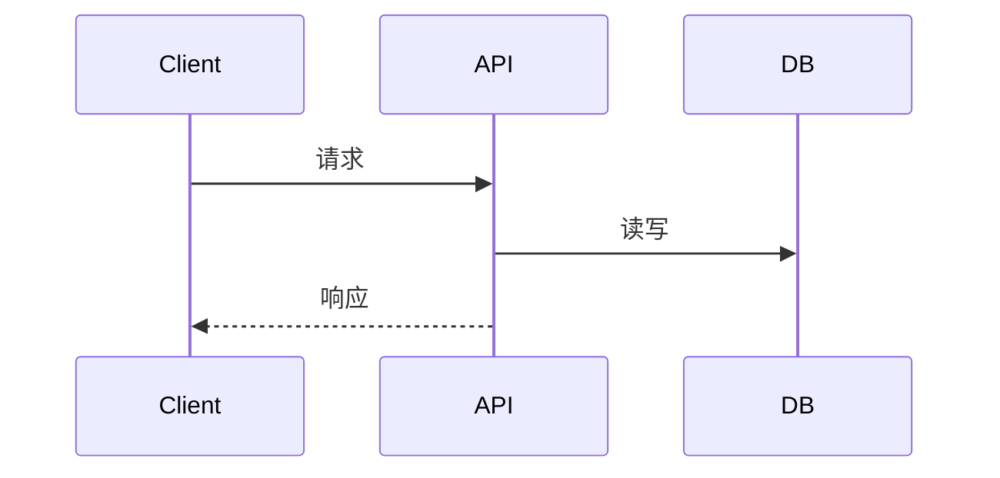

# <功能/模块名称> 技术设计

> 用于单个功能或模块的技术方案。跨模块、影响架构的方案另写 ADR。
> 设计评审通过后再进入开发；设计变更需同步更新本文。

## 1. 背景与目标

- 关联需求：FR-xxx / US-xx
- 目标：
- 非目标：

## 2. 方案概述

- 总体思路（1–2 段）：
- 关键取舍：

## 3. 模块与职责

| 模块/文件 | 职责 | 依赖 |
| --- | --- | --- |
| — | — | — |

## 4. 数据模型变更

- 新增/修改表、字段、索引：
- 迁移方案（前向兼容、回滚）：
- 数据回填与清理：

## 5. API 变更

| 方法 | 路径 | 说明 | 兼容性 |
| --- | --- | --- | --- |
| — | — | — | — |

- 错误码：
- 幂等与限流：

## 6. 关键流程（时序）

## 7. 权限与安全

- 谁能做什么（权限矩阵）：
- 输入校验与输出转义：
- 敏感数据与日志：

## 8. 性能与容量

- 预估 QPS / 数据量 / 存储增长：
- 索引与查询计划：
- 缓存策略与失效：
- 压测计划：

## 9. 兼容性与迁移

- 旧数据/旧客户端兼容：
- 灰度与开关：
- 回滚方案：

## 10. 测试计划

| 类型 | 覆盖点 |
| --- | --- |
| 单元测试 | — |
| 集成测试 | — |
| E2E | — |

## 11. 开放问题

| # | 问题 | 状态 |
| --- | --- | --- |
| 1 | — | open |
